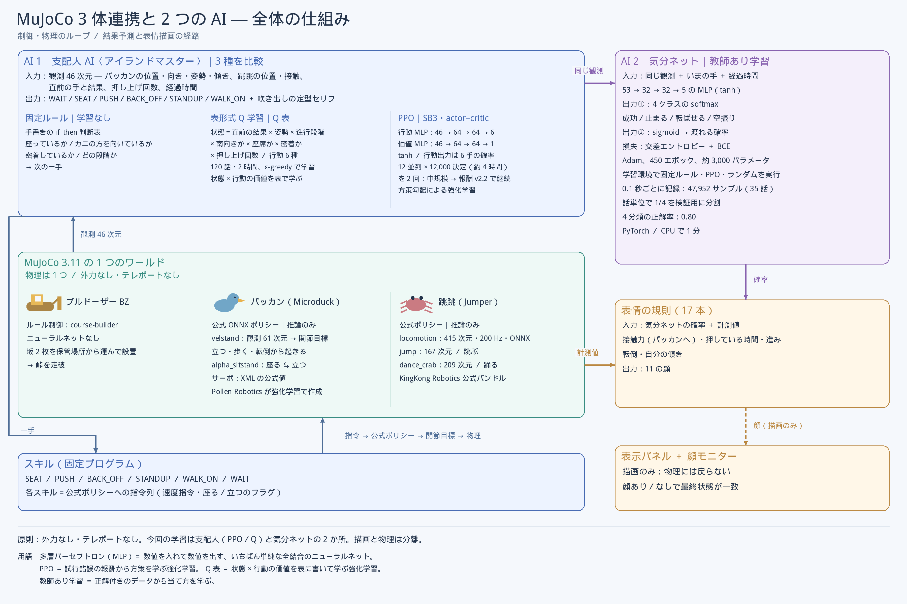
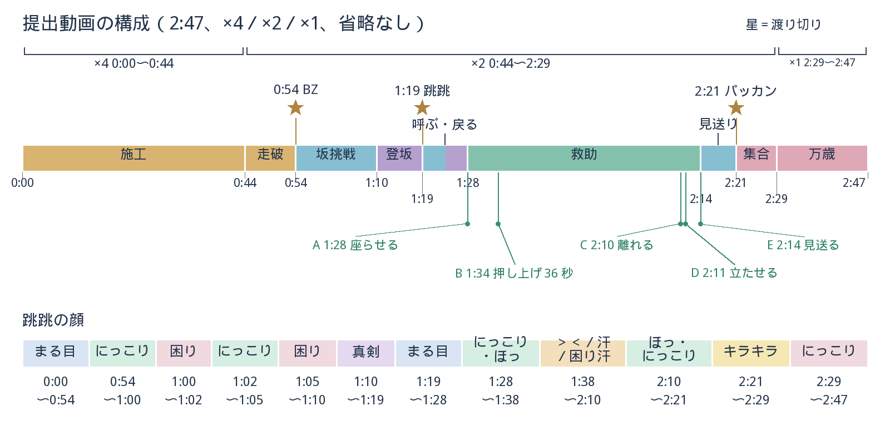

# アイランドマスター：3 体のロボットが 1 つの MuJoCo ワールドで峠を越える

松尾研 Physical AI 応用1 最終課題の提出物。自作のルール制御で動くブルドーザーが坂 2 枚（勾配 16.3°、峠の高さ 0.44 m）を運んで峠を組み、
公式ポリシーだけでは登れない Microduck（愛称パッカン）が坂の入口で座り込み、Jumper（愛称 跳跳＝ちょうちょう、呼び名「ちょーさん」）が後ろから押し上げて 3 体とも渡り切る。
失敗したときの次の一手を選ぶ「支配人 AI」と、跳跳の表情を推論する「気分ネット」の 2 つの自作 AI を本番で推論する。
物理は 1 つの MuJoCo 3.11.0 ワールドで連続し、外力・テレポートは使わない。同一 30 シードの評価では固定ルールの支配人が 29/30、
PPO が 26/30 を渡り切り（`out/manager_runs/comparison_v4.md`）、提出動画の本編では 3 体とも渡り切った（`out/v7_full_report_take57.json` の `three_crossed`）。
提出動画（2:58.4）は講座の OP カード、支配人 AI の自己紹介（15.1 s）、本編（2:37.3）、講座の ED カードを `assemble.py` でつないだもので、自作のマリンバ曲を BGM に敷く。



図：3 体・公式ポリシー 5 本・自作 AI 2 つが 1 つの物理ワールドにどう載るか。中央のワールドから観測が上の支配人 AI へ上がり、一手が下のスキルを経て戻る閉ループと、
右の気分ネット→表情（描画のみ）の経路を読む。出所は本文の各節と [docs/manager_ai.md](docs/manager_ai.md)。

## English summary

One continuous MuJoCo 3.11.0 simulation, no external forces and no teleports: every robot moves only through its own actuators.
A rule-controlled bulldozer (the author's own course builder, `physical-ai-course-builder`) carries two ramps and assembles a 16.3° pass 0.44 m high.
A Microduck (Pollen Robotics, official ONNX policies `velstand` / `alpha_sitstand`, inference only) cannot climb the ramp and sits down at its foot.
A Jumper (KingKong Robotics, official ONNX `locomotion` / `jump` / `dance_crab`, inference only) crosses the pass by itself, comes back,
and pushes the seated duck up the ramp.

Two self-trained networks run inference during the submitted run: a manager policy that picks the next skill for the stuck duck
(rule / PPO / tabular-Q versions; rule 29/30, PPO 26/30 over 30 shared seeds), and a mood net (53-32-32-5 MLP) that drives the Jumper's face.

The submitted video (2:58.4) joins the course's opening card (3.0 s), a 15.1 s self-introduction by the manager AI, the 2:37.3 main video (from 0:18.1) and the course's end card (3.0 s).
In the main video the playback speed is shown at all times (bottom right, with the simulation clock). In submission time: x4 from 0:18.1 to 1:02.2 (construction), x2 to 1:38.5,
x4 from 1:38.5 to 1:42.4 (the duck calls and the crab walks back), x2 from 1:42.4 to 2:34.8 (the rescue), x4 from 2:34.8 to 2:39.0 (gathering for the circle) and x1 from 2:39.0 to 2:55.4 (the circle dance).
There are no jump cuts: every simulated second up to the end of the story (sim 401.7 s) is on screen; of the 2.5 s simulated after it, the first 1 s is shown.
Each manager decision is typed into a band at the bottom of the frame (Japanese, then English); the robots' cries are panned to where each robot is in the frame;
an original marimba piece synthesised by `music/marimba_bgm.py` (no samples, no existing music) plays at a constant level from the end of the opening card.
The face overlay and the mood net do not change the physics: headless A/B runs end in the same state hash and the same manager decisions
(with the mood net, one event message differs in wording only).

Terms: BZ = the bulldozer; Pakkan (パッカン) = the Microduck; Chōchō (跳跳, nickname Cho-san) = the Jumper; manager AI (支配人 AI) = the skill-selection policy; mood net (気分ネット) = the face network.
Code identifiers keep the English names (`MD` / `duck`, `JP` / `crab`, `BZ`; skills `WAIT` / `SEAT` / `PUSH` / `BACK_OFF` / `STANDUP` / `WALK_ON`). Glossary: [docs/glossary.md](docs/glossary.md).

## 提出物と注記

- 提出動画（YouTube、URL は提出時に追記）：2:58.4（178.41 s）、固定ルールの支配人、輪の万歳の結末。講座の OP カード（3.04 s）→ 自己紹介 `out/intro.mp4`（15.1 s、`python intro.py`）→
  本編 `out/3body_arena_v7_take57.mp4`（157.3 s、提出動画の 0:18.1 から）→ 講座の ED カード（2.97 s）を `assemble.py` でつなぐ（各部の長さは `assemble.py` が印字する `parts[].duration_s`）。
  本編の動画ファイルと記録 `out/v7_full_report_take57.json` をリポジトリに同梱する。講座のカード 2 枚は講座の素材なので同梱せず、結合済みの提出ファイルも同梱しない。
- 再生速度（提出動画の時刻＝本編の時刻＋18.14 s）：0:18.1〜1:02.2 は 4 倍速（sim 0〜176.4 s、施工）、1:02.2〜1:38.5 は 2 倍速（sim 176.4〜248.9 s）、
  1:38.5〜1:42.4 は 4 倍速（sim 248.9〜264.6 s、仲間を呼ぶ・跳跳が戻る）、1:42.4〜2:34.8 は 2 倍速（sim 264.6〜369.4 s、救助）、2:34.8〜2:39.0 は 4 倍速（sim 369.4〜386.3 s、輪へ集まる）、
  2:39.0〜2:55.4 は等速（sim 386.3 s から、万歳のダンスと END の後の 1 s）。出所は `python analysis/timeline_times.py out/v7_full_report_take57.json` の speed segments。
  画面右下に sim 時計と x4 / x2 / x1 を常時表示する（`v7_full.py` の footer）。ジャンプカット（省略）はなく、END（sim 401.7 s）までのシミュレーションの全区間が画面に出る
  （END の後に回す 2.5 s のうち書き出すのは最初の 1 s、`--tail-write 1.0`）。4 倍速の区間は 2 倍速で標本化したフレームを 1 枚おきに書くだけで、物理は以前の 2:47 版と同一（`state_digest` `678fd3cae2ca`）。
- 画面と音：支配人 AI が手を選ぶたびに、画面下 1/5 の帯に支配人の丸い顔とセリフが 1 秒 15 文字で打ち込まれ（チャイムと打鍵音つき）、日本語が出そろうと英語の行が出る。
  ロボットの鳴き声はパッカン 1/3・跳跳 1/2 の音量で、鳴いた機体が画面のどこにいるかで左右に振る（ステレオ）。BGM は `music/marimba_bgm.py` が numpy/scipy の加算合成だけで作る自作のマリンバ曲
  （既存の曲・音源・サンプルは不使用、乱数は seed 固定）で、OP カードの終わりから一定の音量で鳴り、最後の和音が ED カードに響く。いずれも描画と音声だけで、物理は変えない。
- 比較用の動画（以前の 2:47 版と同じ速度設定＝施工 4 倍速・以後 2 倍速・ダンス等速、いずれも 3 体渡り切り）：PPO 版 `out/3body_arena_v7_take52.mp4`（2:45、4 手）、Q 表版 `..._take53.mp4`（2:46、8 手）、
  追走の結末 `..._take54.mp4`（2:44、5 手）。長さは各 report JSON の `video_silent.seconds`。本編と物理が同一の以前の 2:47 版 `..._take51.mp4` を比較の基準として残す。
  2 倍速＋省略 2 か所で描いた旧版 `..._take46〜49.mp4` も記録として残す（物理は同一、`state_digest` が一致）。
  比較用の動画と報告 JSON（`out/v7_full_report_take51〜54.json`）、4 倍速の初版の記録 `out/v7_full_report_take50.json` も同梱する。
- レポート PDF：`report/report.pdf`（提出時に追加）。
- ブルドーザー側のリポジトリ [physical-ai-course-builder](https://github.com/ortiz-ai-partners/physical-ai-course-builder) は同一作者の自作（同じ課題のために作成、MIT）。
- AI の使用：本番で推論するのは公式 ONNX ポリシー 5 本（Microduck 2 本・Jumper 3 本）、支配人 AI、気分ネット。学習したのは支配人 AI（PPO・表形式 Q）と気分ネット（いずれも CPU）。
  設計・実装・文書・図の作成には LLM（Claude）の支援を受けた。詳細は「第三者資産・ライセンス・AI の使用」。
- 氏名・所属・メールアドレスは動画・コード・文書に含めない。

## 文書の案内

README は全体の地図で、根拠の全文は次の文書にある。動画から読むなら video_guide → manager_ai → results → insights の順が早い。

| 文書 | 内容 |
|---|---|
| [docs/video_guide.md](docs/video_guide.md) | 提出動画の見方：動画時刻・sim 時刻・場面・機体・制御の対応表 |
| [docs/manager_ai.md](docs/manager_ai.md) | 支配人 AI の設計書：観測 46 次元、6 手、13 種の結果、報酬、3 方式 |
| [docs/mood_net_and_faces.md](docs/mood_net_and_faces.md) | 気分ネットと表情の規則 17 本、顔と気分ネットが物理を変えないことの検証 |
| [docs/results.md](docs/results.md) | 同一シード評価の全表、失敗の型、提出動画の本編と比較用の動画の手と時刻 |
| [docs/insights.md](docs/insights.md) | 分かったこと・限界・反省の長版（事実→原因→対処） |
| [docs/physics_integration.md](docs/physics_integration.md) | 技術ノート：3 体の MJCF と公式 ONNX 5 本を 1 つのワールドに統合する要点 |
| [docs/reproduce.md](docs/reproduce.md) | 再現手順の全文：環境、隣接リポジトリ、全コマンドと照合値 |
| [docs/glossary.md](docs/glossary.md) | 用語対応表：呼び名・正式名・英語・コード識別子 |
| [THIRD_PARTY.md](THIRD_PARTY.md) | 第三者資産の出典・版・ライセンスと AI の使用 |
| [archive/README.md](archive/README.md) | 採用しなかった設計と旧世代のスクリプト（import されない） |
| [docs/devlog/README.md](docs/devlog/README.md) | 開発記録の索引：原文のまま保存した記録と訂正表 |

## 課題設定と 3 つの原則

1. 1 つのワールド：3 体を 1 つの MuJoCo 3.11.0 モデルに `MjSpec.attach` で結合し（名前空間 `md-` / `jp-`、`v6_robots.py`）、同時に物理シミュレーションする（report JSON の `mujoco`）。
2. 外力・テレポートなし：各機体は自分のアクチュエータだけで動く。Microduck のサーボは XML の公式値（kp 0.55、±0.96 Nm、`v7_full.py` の `official_md_servos`）。
   例外は学習環境のリセット配置のみで、動画には出ない。外力（`xfrc_applied`）を使った旧版は採用せず [archive/](archive/README.md) に残した。
3. 公式ポリシーは推論のみ・改変なし：ONNX をそのまま読み、観測の契約を転記して渡す（`v7_policies.py`）。

付記：顔・字幕・気分ネットは描画専用で物理を変えない。顔あり／なしのヘッドレス通しで最終状態（qpos＋qvel）の sha256 が一致することを確認した
（`analysis/face_check.py`、`out/v7_full_report_facecheck_A.json` と `_B.json` の `state_digest`）。気分ネットありの通し（`out/v7_full_report_moodcheck_C.json`、推論 4,518 回）とも
digest・支配人の判断・モード変化・渡り切りが一致し、違いは出来事 1 件の文言だけだった（[docs/mood_net_and_faces.md](docs/mood_net_and_faces.md)）。これはヘッドレスの経路どうしの比較で（digest `c083a03c2625`）、
描画版の提出動画（digest `678fd3cae2ca`）とは経路が別である（描画ごとの `mj_forward`、[docs/reproduce.md](docs/reproduce.md) §5.3）。時間刻みは施工中 0.005 s、施工完了（sim 196.1 s）以後 0.001 s。

## 登場する 3 体と 2 つの AI

| 機体 | 正式名・製作元 | 動かしているもの | 既製／自作 | 推論／学習 |
|---|---|---|---|---|
| ブルドーザー（BZ） | 自作 `physical-ai-course-builder`（MJCF とルール制御） | `SlopeAssembly` / `Transport` / `Navigator` のルール制御 | 自作 | AI 推論なし |
| パッカン | Microduck（Pollen Robotics）、`microduck_rl` の MJCF | `velstand.onnx`（観測 61、50 Hz）、`alpha_sitstand.onnx`。HF `pollen-robotics/microduck-policies` から取得（学習元 `microduck_rl` commit 3750776 / 77ffadf） | 既製 | 推論のみ |
| 跳跳 | Jumper（KingKong Robotics）、公式バンドル | `locomotion`（観測 415、200 Hz）、`jump`（167、200 Hz）、`dance_crab`（209、50 Hz）の ONNX | 既製 | 推論のみ |

| AI | 役割 | 構成 | 既製／自作 | 推論／学習 |
|---|---|---|---|---|
| 支配人 AI | 失敗したときの次の一手を 6 手から選ぶ | 観測 46 次元、固定ルール／SB3 PPO（MLP 64×64）／表形式 Q | 自作 | 学習＋推論 |
| 気分ネット | 走っている手の結末を推論し、跳跳の表情に結ぶ | 53-32-32-5 の MLP（PyTorch、CPU） | 自作 | 学習＋推論 |

跳跳の前方ジャンプは公式 `jump` の関節目標に股関節ヨーの後方掃きを重ねたもので、外力は使わない（`v7_policies.py` の `SWEEP_SIGN`）。
観測契約の転記元は Microduck が `microduck_rl/scripts/infer_policy.py`、Jumper が `deploy/fsm/src/obs.rs`。以後は愛称に統一する（対応表 [docs/glossary.md](docs/glossary.md)）。

## 動画で起きていること（時間軸）

提出動画（2:58.4）の場面ごとに、動いている機体と制御の出どころを並べる。時刻は提出動画の時刻で、本編の時刻（`out/v7_full_report_take57.json` の `events[].video_t`）に
講座の OP カードと自己紹介の長さ 18.14 s（3.04＋15.1、`assemble.py` の `parts[].start_s`）を足して算出した。sim 時刻は同じ JSON の `events[].t`。



図：上のかっこが再生速度、帯が場面と主役（色）、星が渡り切り、A〜E が支配人 AI の 5 手、下の帯が跳跳の顔。出所は `out/v7_full_report_take51.json`。
この図は以前の 2:47 版（物理は本編と同一、`state_digest` `678fd3cae2ca`）の動画時刻で描いてあり、最終版の時刻は下の表のとおり。

| 動画時刻 | 場面 | 動いているもの | 制御 | 既製／自作 |
|---|---|---|---|---|
| 0:00〜0:03 | 講座の OP カード（講座の素材、リポジトリに含まない） | — | — | 講座の素材 |
| 0:03〜0:18 | 自己紹介：支配人 AI が丸い顔と打ち込みの文字で名乗り、3 体をカードで紹介する（各文の下に英語、打鍵音とチャイム） | 支配人 AI の顔（描画のみ） | `intro.py`（物理を進めない描画と効果音の合成） | 自作 |
| 0:18〜1:02（×4） | 本編の始まり。ブルドーザーが坂 2 枚を保管場所から運び、峠を組む。空荷の往復も省略しない | ブルドーザー | course-builder のルール制御 | 自作、AI 推論なし |
| 1:02〜1:12（以後 ×2） | ブルドーザーが峠を渡る。パッカンが後を追って坂の足元へ。1:12（sim 196.1 s）に施工完了＝4/4 面を走破 | ブルドーザー、パッカン | ルール制御／`velstand` | 自作／既製 |
| 1:12〜1:26 | パッカンが 16° の坂に 2 回挑み、入口で足踏みして 1:26（sim 224.6 s）に座り込む。跳跳は横で応援のダンス | パッカン、跳跳 | `velstand`・`alpha_sitstand`／`dance_crab` | 既製 |
| 1:28〜1:37 | 跳跳が坂を登り、1:34（sim 239.0 s）に天面でジャンプ、1:37（sim 245.9 s）に渡り切る | 跳跳 | `locomotion`・`jump`（前方ジャンプは関節目標の重ね） | 既製＋自作の工夫 |
| 1:37〜1:42（1:38.5 から ×4） | パッカンが仲間を呼ぶ。跳跳がコースの東側を回って座席の後ろへ戻る | パッカン、跳跳 | 固定プログラム（台本） | 自作 |
| 1:42〜2:28（×2） | 支配人 AI の 5 手：1:42.4 座らせる、1:48.4 押し上げ（動画で約 36 秒、sim 71 s）、2:24.0 離れる、2:24.9 立たせる、2:27.7 見送る。手を選ぶたびに画面下の帯に支配人の顔とセリフ（日本語→英語）が出る | 支配人 AI → 跳跳・パッカン | 自作 AI（固定ルール）＋スキル | 自作 |
| 2:28〜2:35 | パッカンが天面を歩き、下り坂を降りる。跳跳が後ろについて越える。ブルドーザーが向き直る。2:35（sim 369.4 s）にパッカン渡り切り | 全員 | `velstand`／`locomotion`／ルール制御 | 既製・自作 |
| 2:35〜2:39（×4） | 3 体がゴール前に集まる | 全員 | 固定プログラム | 自作 |
| 2:39〜2:55（×1） | 輪になって万歳：フォークの上下、屈伸と首振り、ハサミを上げるダンス。END（2:54.4、sim 401.7 s）の 1 s 後に本編が終わる | 全員 | ルール制御／`velstand`／`dance_crab` | 自作／既製 |
| 2:55〜2:58 | 講座の ED カード（講座の素材）。BGM の最後の和音がここまで響く | — | — | 講座の素材 |

支配人 AI の 5 手は `SEAT` → `PUSH` → `BACK_OFF` → `STANDUP` → `WALK_ON` で全て成功し、転倒 0、コースの部材の移動なし（`manager.decisions`、`course_disturbed`）。
右上の顔モニター（240×120、`crab_face.py` の `PIP_W` / `PIP_H`）は気分ネットの推論（本番で 5,236 回、`face.mood_ai.inferences`）と「決め手の値」を表示し、表情の切替は 25 回（`face.log` は初期状態を含めて 26 行）。
表の時刻は秒に丸めた（支配人の 5 手だけ小数 1 桁、`manager.decisions[].video_t`＋18.14 s）。本編の全時刻は `python analysis/timeline_times.py out/v7_full_report_take57.json` で出せ、18.14 s を足すと提出動画の時刻になる。長版は [docs/video_guide.md](docs/video_guide.md)。

## AI 1：支配人 AI — 失敗したときの次の一手を選ぶ

### 問題設定

観測は 46 次元（3＋2＋4＋2＋進行段階 6＋7＋直前の結果 13＋手 6＋3、`crab_help.py` の `OBS_DIM`。内訳は [docs/manager_ai.md](docs/manager_ai.md)）。
手は `WAIT` / `SEAT` / `PUSH` / `BACK_OFF` / `STANDUP` / `WALK_ON` の 6 つ（`ACTIONS`）で、各手は固定プログラムのスキルとして走り、終わると 13 種の結果（`RESULT_SLOTS`）を返す。
吹き出しは手ごとの定型文（`LINES`）。1 ステップ＝1 スキル、1 話は最大 240 s、開始場面は 7 種（足元で座り・別向き・立ち・転倒、天面で座り・転倒、坂の途中で転倒、`manager2_env.py` の `SCENARIOS`）。
報酬（`REWARD`）：渡り切り +10、経過 −0.03/s、天面到達 +3、転倒 −1、無駄な手 −1、無人で待つ −0.5、時間切れ −5、コース破損（部材が 4 cm 動く）−10。
報酬 v2.2 は転んだ相手への `SEAT` / `STANDUP` も無駄な手に数える（学習のみ、評価は v2.1 で統一）。

### 3 つの方式

| 方式 | モデル | 学習量 | 実時間 | 出所 |
|---|---|---|---|---|
| 固定ルール | `crab_help.rule_action`（条件分岐） | なし | なし | `crab_help.py` |
| PPO | SB3 `MlpPolicy` [64,64]、12 並列 | 12,000 決定（`ppo2_medium2`）＋報酬 v2.2 で継続 12,000 決定（`ppo2_v22`） | 4 h 13 min ＋ 4 h 28 min | `out/manager_runs/{ppo2_medium2,ppo2_v22}/train_summary.json` |
| 表形式 Q | 状態キー 7 要素（直前の結果・姿勢・段階・向き・座席・密着・押し回数）、314 状態 | 120 話 | 1 h 59 min | `out/manager_runs/tabq2_small/train.log`、`tabq.json` |

固定ルールの要点：座っていて、跳跳の方を向いていて、座席か坂の上か縁の近くにいれば `PUSH`。押しが止まった直後に密着していれば `BACK_OFF`。
転んだ相手には密着していれば `BACK_OFF`、そうでなければ `WAIT`（転んだ相手を起こす手は行動集合にない）。

### 鍵の発見

座ったパッカンが跳跳の方（坂と反対）を向くと、押されている間の傾きは 6〜12° にとどまり縁で倒れない。坂の上を向いて座ると約 40° 後傾して縁で転倒する
（`v7_test_crab_push.py` の実験。角度は開発記録の計測値で、再計算スクリプトはない）。この向きの条件を `SEAT` スキルと固定ルールに組み込んだ。詳細は [docs/manager_ai.md](docs/manager_ai.md)。

## AI 2：気分ネット — 跳跳の表情を推論する

最初の案は PPO の批評家 V(s) を気分に使うことだったが、押しで密着している間の V の平均が −21.2（PPO 走行、n 3,842）／−21.9（固定ルール走行、n 4,202）と低く、
天面に着く直前まで絶望と読むため採用しなかった（`out/manager_runs/face_value.md` の「skill x contact」。成功・失敗を含む標本全体の平均）。代わりに「走っている手がどう終わるか」を直接学習する小さなネットを作った。

入力 53（観測 46＋手の one-hot 6＋経過時間/60 s）→ 32 → 32 → 5（成功／止まる／転ばせる／空振り の softmax 4 と、渡れる の sigmoid 1、tanh）。
学習データは学習環境で固定ルール・PPO・ランダムの支配人を 7 場面で走らせた 35 話・47,952 サンプル（0.1 s ごと、`analysis/mood_data.py`）。
話単位で 1/4 を見送りにし、600 エポック中 450 エポック目を採用。見送り分 10,772 サンプルで 4 分類 0.80、成功 vs 失敗 0.80（均衡正解率 0.83）、渡れる 0.67。
学習ループは CPU で 3.5 s（`out/manager_runs/mood_net/meta.json` の `metrics`、`train_s`、`analysis/mood_train.py`）。

表情は 11 種、優先順の規則 17 本で決める（`crab_face.py`）。計測値（傾き 50° で目を回す `TILT_ON`、接触力÷10 N の力 0.70 以上で汗 `EFFORT_HI`、
押して 5 s で汗 `PUSH_SWEAT_S`、停滞は 2 s 窓・押し中 3 s `STALL_S` / `PUSH_STALL_S`）と推論値（p(転ばせる) ≥ 0.30 `P_FALL` など）を組み合わせ、
顔モニターに決め手の値を出す。本番では制御周期 0.02 s ごとに推論する。表情の一覧は `report/faces_sheet_ja.png`、詳細は [docs/mood_net_and_faces.md](docs/mood_net_and_faces.md)。

## 結果


図：評価 v4（新コース、30 シード）の渡り切り数と、固定ルールとの同一シード 2×2。帯の長さが渡り切り数、印が 2×2 の内訳。出所 `out/manager_runs/comparison_v4.md`。

評価 v4：峠の継ぎ目 1 cm の新コース、30 シード（5000〜5029）を全方式で共有、決定的方策、開始場面は乱数（`manager2_train.py eval`、`manager2_tabq.py eval`）。

| 方式 | 渡り切り | 天面到達 | 無駄な手／話 | 転倒／話 | 学習コスト（CPU） |
|---|---|---|---|---|---|
| 固定ルール | 29/30 | 100% | 0.07 | 0.33 | なし |
| PPO v2.2（`ppo2_v22`） | 26/30 | 97% | 0.60 | 1.03 | 8 h 41 min（累計） |
| 表形式 Q（`tabq2_small`） | 25/30 | 97% | 5.17 | 0.73 | 1 h 59 min |
| PPO 中規模（`ppo2_medium2`） | 23/30 | 83% | 0.47 | 0.87 | 4 h 13 min |
| ランダム | 14/30 | 73% | 8.20 | 1.53 | なし |

コース破損は全方式 0。渡った回の中央時間は PPO 中規模が 79 s で最速、固定ルール 90 s（`comparison_v4.md`）。
天面転倒（抽選の重み 0.05）は 30 本の抽選に出ず、坂の途中の転倒は既定の抽選表で重み 0 のため評価には含まれない（場面別の表で 0/0）。
重みの出所は `manager2_env.py` の `SCENARIOS`。継続学習 `ppo2_v22` だけ坂の途中の転倒を 0.20 で抽選した（`out/manager_runs/ppo2_v22/train_summary.json` の `draw_tables`）。

| 方式 | 両方渡った | ルールだけ渡った（判断の失敗） | 方策だけ渡った | 両方失敗（スキルの失敗） |
|---|---|---|---|---|
| PPO v2.2 | 25 | 4 | 1 | 0 |
| 表形式 Q | 24 | 5 | 1 | 0 |
| PPO 中規模 | 22 | 7 | 1 | 0 |
| ランダム | 14 | 15 | 0 | 1 |

固定ルールとの同一シード 2×2 で、「ルールは渡ったが方策は失敗」を判断の失敗、「両方失敗」をスキルの失敗として分ける（`comparison_v4.md`「失敗の帰属」、`manager2_report.py` が生成）。

動画との対応（いずれも 3 体渡り切り・コース破損なし、`out/v7_full_report_take57.json` と `take51〜54.json` の `three_crossed`、`course_disturbed`、`manager.decisions`）：
提出動画の本編は固定ルール 5 手（本編 2:37、以前の 2:47 版と同じ手と sim 時刻）。比較用は以前の 2:47 版と同じ速度設定で、PPO 版は 4 手で `BACK_OFF` を省く（2:45）、
Q 表版は 8 手で `STANDUP` → `WALK_ON` が止まってから座らせ直す（2:46）、追走版は固定ルール 5 手（2:44）。
旧コース（継ぎ目 5 cm）の評価と修正の効果は [docs/results.md](docs/results.md)。

## 工夫点

- 創造性：公式ポリシーが 16° の坂を登れない事実を隠さず物語の核にし、座った相手を別のロボットが押し上げる結末を作った。
- 創造性：「相手の方を向いて座ると縁で倒れない」という実験の発見を `SEAT` スキルの仕様にした。
- 技術力：3 系統の MJCF と 5 本の ONNX を 1 ワールドに統合し（`MjSpec.attach`、名前空間、PD アクチュエータの追加）、ポリシー切替の周期と観測契約を転記で合わせた（[docs/physics_integration.md](docs/physics_integration.md)）。
- 技術力：同一シード評価と 2×2 帰属で判断の失敗とスキルの失敗を分け、顔・気分ネット・倍速の有無で物理が同一であることを最終状態の sha256 で検証した。
- 技術力：前方ジャンプを公式 `jump` への関節目標の重ね合わせだけで実現した（外力なし）。
- 実用性：スキル（固定プログラム）と判断（AI）を分けたので学習は CPU 数時間で済み、固定ルール 1 本でも 29/30 に届く。
- 実用性：峠の継ぎ目でパッカンがつまずく問題を施工精度（継ぎ目 5 → 1 cm、course-builder commit ea5b4e7）で解決し、環境の不備を学習に押し付けなかった。
- 表現力：顔モニターに決め手の数値、右下に倍速と sim 時計、判断の瞬間だけ吹き出しと画面下の帯（日本語と英語）。鳴き声は機体の画面上の位置で左右に振る。省略なしで全区間を見せる。

## 分かったこと・限界・反省

1. 固定ルールが学習方式に勝った。手 6・結果 13 の離散問題では設計者の知識を直接書ける。評価 v4 では、失敗した押しの直後に固定ルールは 8/8 で `BACK_OFF` したが、
   PPO 中規模は押しで転ばせた直後に `BACK_OFF` を 2/7 しか選べなかった（各 `eval_*.json` の `actions`・`results` の集計、再計算スクリプトなし、[docs/results.md](docs/results.md)）。
   学習方式の価値は、設計者が条件を書き切れない場面に残る。
2. PPO 中規模の失敗 7 本中 5 本は転んだ相手への `SEAT` 連打だった（`out/manager_runs/ppo2_medium2_v4/eval_ppo.json`）。
   うち 4 本は `SEAT` を 20〜24 回選び、その結果が `still_down`（相手が倒れたまま）だった回は 18〜24 回。
   報酬 v2.1 では時間しか引かれず学ぶ圧力がなかった＝報酬設計の不足。報酬 v2.2 で無駄な手として教え、評価ではその型が 0 本になった（`ppo2_v22_v4/eval_ppo.json`）。
3. 評価エピソードが独立していなかった。`Scene.reset` が `mj_resetData` を呼んでおらず、同じシードで `PUSH` の所要時間が変わった＝評価環境の不備。
   `mj_resetData` を入れて修正し（`manager2_env.py`）、修正前の表（`out/manager_runs/comparison_v2.md`）は開発記録としてのみ残す。
4. 環境の不備は学習方式に厳しく出る。継ぎ目 5 cm の旧コースでは PPO v2.2 が 16/30、固定ルール 23/30 だったが、1 cm にすると 26/30 と 29/30 になった
   （`out/manager_runs/comparison_v3b.md` と `comparison_v4.md`）。学習前に環境の精度を疑うべきだった。
5. スキルの精度の限界。押し上げは正しい状態で呼んでも、評価 v4（新コース）の固定ルールで 22/30＝73%（`out/manager_runs/baselines_v4/eval_rule.json` の集計、[docs/manager_ai.md](docs/manager_ai.md)）、
   旧コース（継ぎ目 5 cm）の評価 v2 では 22/35＝63%（決定ログの集計、再計算スクリプトなし、[docs/devlog/MANAGER_DESIGN.md](docs/devlog/MANAGER_DESIGN.md) §7.6）にとどまる。
   固定ルール唯一の失敗（seed 5021、`out/manager_runs/baselines_v4/eval_rule.json`）は下り坂側で転んだ相手に打つ手が行動集合にない型。
   公式 `velstand` は 16° を登れず、歩行指令 0.3 m/s に対し実速は約 0.10 m/s（開発記録の計測値）。これは公式ポリシーの設計範囲の外であり、本作はそれを前提に物語を組んだ。
6. 描画と物理の分離は検証しないと破れる。省略の初版は描画経路の `mj_forward` が抜けて物理が変わり（開発記録）、4 倍速の初版（`out/v7_full_report_take50.json`）は描画の標本周期を変えて経路が変わった。
   いずれも最終状態の sha256 で見つけ、2 倍速で標本化したフレームを間引く実装に直した。残る限界：シミュレーションのみ、固定コース 1 種、字幕は日本語フォントに依存、
   ブルドーザーが相手を持ち上げる結末は安全上の理由で捨てた（[archive/v7_test_fork.py](archive/v7_test_fork.py)）。長版は [docs/insights.md](docs/insights.md)。

## 再現方法

環境：Python 3.10、`pip install -r requirements.txt`（mujoco 3.11.0、onnxruntime 1.23.2、stable-baselines3 2.9.2、torch CPU、gymnasium 1.0.0、imageio＋imageio-ffmpeg、Pillow、numpy、glfw。版は `requirements.txt`）。
隣接リポジトリを親ディレクトリに並べる（`v6_common.py` の `BASE`）。Microduck の ONNX は `policies/microduck/` に同梱。
Jumper の公式バンドルは jumper リポジトリの `out/bundle_example/jumper/`（`locomotion.json`、`jump.json`、`dance_crab.json` ほか）に git 追跡で同梱されており、clone に含まれる（生成は不要）。

```
<parent>/
  mujoco_3body/                  このリポジトリ（名前は任意。clone の既定名は mujoco-3body）
  physical-ai-course-builder/    ブルドーザー（自作、commit ea5b4e7）
  microduck_rl/                  Microduck の MJCF（Pollen Robotics）
  jumper/                        Jumper の MJCF と公式バンドル out/bundle_example/jumper（KingKong Robotics）
```

| 番号 | コマンド（リポジトリルートで） | 所要時間 | 出力と照合先 |
|---|---|---|---|
| 1 | `python v6_phase1_build.py` | 数分 | `out/v6_stage_built.xml`（学習環境と単体実験の舞台） |
| 2a | `python v7_full.py --test --no-face --tag _A` | 約 1.5 分（描画なし） | `out/v7_full_report_A.json`（顔なし） |
| 2b | `python v7_full.py --test --tag _B` | 約 1.5 分（描画なし） | `out/v7_full_report_B.json`（顔と気分ネットあり） |
| 2c | `python analysis/face_check.py out/v7_full_report_facecheck_A.json out/v7_full_report_facecheck_B.json` | 数秒 | 同梱の組で 8 項目すべて same、ngeom 290→291、終了コード 0 |
| 3 | `python v7_full.py --tag _take57 --build-speed 4 --no-cuts --speedup CALL=4 --speedup RETURN=4 --speedup CELEBRATE=4 --tail-write 1.0` | 約 5〜8 分 | 本編 `out/3body_arena_v7_take57.mp4`（157.3 s、ステレオ音声）＋報告 JSON（5 手、digest `678fd3cae2ca`） |
| 3a | `python intro.py` | 約 10 秒 | 自己紹介 `out/intro.mp4`（15.1 s、`intro.py` の `DURATION`） |
| 3b | `python music/marimba_bgm.py` | 約 20 秒 | BGM `out/music/bgm_marimba.wav`（44,100 Hz・ステレオ・175.4 s、同ファイルの `DUR`） |
| 3c | `python assemble.py --op <講座の OP> --intro out/intro.mp4 --main out/3body_arena_v7_take57.mp4 --ed <講座の ED> --out out/submission.mp4 --bgm out/music/bgm_marimba.wav --bgm-gain -16 --bgm-until end --bgm-fade 0` | 約 30 秒 | 提出動画 `out/submission.mp4`。印字の `total_s` 178.41、`parts[].start_s` 0／3.04／18.14／175.44 |
| 3d | `python v7_full.py --tag _take51 --build-speed 4 --no-cuts` | 約 5〜8 分 | 以前の 2:47 版 `..._take51.mp4`＋報告 JSON（5 手、digest `678fd3cae2ca`、本編と同一） |
| 3e | `python v7_full.py --manager ppo --run ppo2_v22 --tag _take52 --build-speed 4 --no-cuts` | 約 5〜8 分 | PPO 版 `..._take52.mp4`＋報告 JSON（4 手、digest `aafa49e7a869`） |
| 3f | `python v7_full.py --manager tabq --run tabq2_small --jitter 0.4 --tag _take53 --build-speed 4 --no-cuts` | 約 5〜8 分 | Q 表版 `..._take53.mp4`＋報告 JSON（8 手、digest `f53de6e45af7`） |
| 3g | `python v7_full.py --finale procession --tag _take54 --build-speed 4 --no-cuts` | 約 5〜8 分 | 追走版 `..._take54.mp4`＋報告 JSON（5 手、digest `be8fb01e8f90`） |
| 4 | `python manager2_train.py eval --run baselines_v4 --policies rule random --episodes 30 --seed0 5000 --out baselines_v4_rerun` | 約 1 h | rule 29/30、random 14/30（`eval_summary.json`） |
| 5 | `python manager2_report.py --runs baselines_v4 tabq2_small_v4 ppo2_medium2_v4 ppo2_v22_v4 --name comparison_v4` | 数秒 | `out/manager_runs/comparison_v4.md` |
| 6 | `python analysis/mood_train.py --data mood_data --out mood_net_rerun --epochs 600 --hidden 32 --seed 0` | 1 分以内 | `meta.json`（best_epoch 450、見送り分の 4 分類 0.80） |

報告 JSON は `out/v7_full_report<tag>.json`、digest は `state_digest` の先頭 12 桁、照合値の出所は同梱の `out/v7_full_report_take57.json` と `take51〜54.json`。
3c の `<講座の OP>`・`<講座の ED>` は講座が配布するカード（同梱しない）で、`assemble.py` は 1280×720・30 fps にそろえ、音のないカードには無音を入れ、BGM を OP カードの終わり（`--bgm-start` の既定）から一定の音量で重ねる。
4 の出力は `out/manager_runs/baselines_v4_rerun/`、6 の出力は `out/manager_runs/mood_net_rerun/` で、同梱の `baselines_v4/` と `mood_net/` を上書きせずに照合できる。
6 の学習ループは 3.5 s で、「1 分以内」はスクリプト全体の目安（`out/manager_runs/mood_net/meta.json` の `train_s`）。

2c は同梱の組（表情ログ `face.log` の行が 3 要素だった時期の報告）で終了コード 0 になり、`VERDICT: identical physics path` を印字する。
現行コードの表情ログは 1 行 5 要素（規則番号と計測値を足した）なので、2a・2b で新しく作った組を渡すと、8 項目の same／DIFFERS と ngeom の行を印字した後、
表情ログの一覧で止まる（終了コード 1、`VERDICT` 行なし）。新しい組は印字された 8 項目で判定する。`face_check.py` は digest が一致していても出来事が 1 件違えば終了コード 1 を返す。
本編と以前の 2:47 版の物理同一は `python analysis/timeline_times.py out/v7_full_report_take57.json --compare out/v7_full_report_take51.json` の末尾
`state_digest equal: True` で確かめられる（出来事の動画時刻は CALL から −0.4〜−8.2 s ずれ、sim 時刻は同じ）。2:47 版と 2 倍速＋省略版の組は `take51.json --compare take46.json` で同じ行が出る。
同じコマンドはヘッドレスの報告どうしにも使える（[docs/reproduce.md](docs/reproduce.md) §4.3）。

3・3d〜3g の `--tag` は同梱ファイルの名前で、同じ tag で描くと同梱の mp4 と報告 JSON を上書きする。同梱の版を残して比べるときは `--tag _rerun57` などの別名で描き、上の `--compare` で照合する。
同じコード・同じ引数の描画は毎回同じ経路をたどる。描画のたびに呼ぶ `mj_forward` も経路の一部で、ヘッドレスの `--test`（sim 385.6 s）は描画版（sim 404.22 s）と経路が異なる（[docs/reproduce.md](docs/reproduce.md) §5.3）。
`--manager` は支配人の判断から先、`--finale` は結末の経路を変える。`--jitter` は同じ設定のまま描画の経路を変えるための引数で、報告 JSON には記録されない（Q 表版は 0.4）。

PPO v2.2 の重み `out/manager_runs/ppo2_v22/ppo_manager.zip`、Q 表 `tabq2_small/tabq.json`、気分ネット `mood_net/mood_net.pt` はリポジトリに含まれる。
Windows 以外では字幕のフォントが既定に退避する。cp932 のコンソールでは `PYTHONIOENCODING=utf-8` を設定する。学習の再実行と残りのコマンドは [docs/reproduce.md](docs/reproduce.md)。

## リポジトリ構成

| パス | 役割 |
|---|---|
| `v7_full.py` | 本番の通し台本：施工→坂の挑戦→跳跳の越境→支配人 AI の救助→万歳を 1 本の連続シミュレーションで回し、動画（本編）と report JSON を書く |
| `intro.py` | 提出動画の自己紹介（15.1 s）：支配人 AI の丸い顔、打ち込みの文字、3 体のカード、打鍵音とチャイム。物理は進めない描画のみ |
| `music/marimba_bgm.py` | 提出動画の BGM：numpy/scipy の加算合成だけで作る自作のマリンバ曲（seed 固定、`out/music/bgm_marimba.wav`） |
| `assemble.py` | 提出動画の結合：講座の OP カード＋自己紹介＋本編＋講座の ED カードをつなぎ、BGM を一定の音量で重ねる |
| `v7_policies.py` | 公式 ONNX ポリシーの観測転記（Microduck 61 次元、Jumper locomotion / jump / dance_crab） |
| `v6_robots.py`、`v6_common.py` | 3 体の結合（`MjSpec.attach`）と共有ヘルパー（字幕、カメラ、動画） |
| `crab_help.py` | 支配人 AI のスキル 6 手、観測 46 次元、固定ルール、吹き出しの定型文 |
| `crab_face.py` | 跳跳の表情 11 種、気分ネットの推論、優先規則 17 本、顔モニター |
| `manager2_env.py`、`manager2_train.py`、`manager2_tabq.py`、`manager2_report.py` | 学習環境（gymnasium）、SB3 PPO、表形式 Q、同一シード評価の比較表 |
| `analysis/` | 気分ネットの収集・学習、顔の A/B 検査、時間軸の算出、学習・評価ログの集計 |
| `v7_test_*.py` | 単体実験（押し上げの鍵実験、万歳、公式ポリシーの確認、顔の煙試験） |
| `v6_phase1_build.py`、`v6_phase4_full.py` | 旧名だが現役の依存先（舞台 XML の生成、`ArenaSim`。`v7_full.py` と `manager2_env.py` が import） |
| `v7_progress_video.py` | 単体実験 `v7_test_collision.py` / `v7_test_head_reach.py` / `v7_test_sitstand.py` の依存先（`official_md_servos` の同一コピーを持つ。本番は `v7_full.py` の自前版） |
| `policies/microduck/` | 同梱の Microduck 公式 ONNX と `manifest.json` |
| `out/` | 生成物：report JSON、評価 JSON、学習済み方策、提出動画の本編と自己紹介、比較用の動画、舞台 XML（BGM の wav と結合済みの提出ファイルは含めない） |
| `report/` | 図と最終 PDF |
| [docs/](docs/) | 読者向け文書（動画の対応表、支配人 AI、気分ネット、結果、考察、再現、物理統合、用語。一覧は「文書の案内」） |
| [docs/devlog/](docs/devlog/) | 開発記録（原文のまま保存、索引は [docs/devlog/README.md](docs/devlog/README.md)） |
| [archive/](archive/) | 不採用・旧世代のコード（外力版、支配人 v1、旧描画。import されない。説明は [archive/README.md](archive/README.md)） |

`out/v7_full_report_take*.json` には最終状態の sha256（`state_digest`）、出来事（`events`）、支配人の判断（`manager.decisions`）、表情ログ（`face.log`）が入り、動画がなくても物理同一の検証ができる。

## 第三者資産・ライセンス・AI の使用

コードは MIT ライセンス（[LICENSE](LICENSE)）。Microduck の外観（CC BY-NC-SA 4.0 の 3D メッシュ）を含む動画（本編 `out/3body_arena_v7_take57.mp4`、比較用の `..._take51〜54.mp4` ほか）、
自己紹介 `out/intro.mp4`、`report/*.png` は CC BY-NC-SA 4.0（帰属：Pollen Robotics、`microduck_rl`）に従う。提出動画の前後の OP／ED カードは講座の素材で、本リポジトリのライセンスの対象外である。
BGM は本作の作者が `music/marimba_bgm.py` で合成した自作の曲で、第三者の曲・音源を含まない。第三者資産の全文一覧は [THIRD_PARTY.md](THIRD_PARTY.md)。

| 資産 | 提供元 | ライセンス | 使い方 |
|---|---|---|---|
| Microduck 公式 ONNX（`velstand`、`alpha_sitstand`） | Pollen Robotics、HF `pollen-robotics/microduck-policies`（版は `manifest.json`） | 未確認（表の下の注記） | 推論のみ、同梱。`alpha_walking` / `alpha_stand` は同梱するが未使用 |
| `microduck_rl` の MJCF | Pollen Robotics | Apache-2.0（3D モデルは CC BY-NC-SA 4.0） | シーンとして読み込む、同梱せず |
| Jumper の MJCF と公式バンドル | KingKong Robotics | Apache-2.0 | 推論のみ、観測契約を `obs.rs` から転記、同梱せず |
| `physical-ai-course-builder` | 本作の作者（自作） | MIT | ブルドーザーの MJCF とルール制御。`rsplan`（Built Robotics、MIT）を版固定で同梱 |
| MuJoCo、Stable-Baselines3、gymnasium、onnxruntime、PyTorch、imageio、Pillow | 各プロジェクト | 各ライセンス | 物理、学習、推論、描画 |

注記：Microduck 公式 ONNX は配布元（Hugging Face）のライセンス表示を確認できていない。本リポジトリでの同梱は配布元の表示に従い、確認後に追記する。表示が無い場合は同梱を取得手順に置き換える（[THIRD_PARTY.md](THIRD_PARTY.md) と同じ扱い）。

AI の使用：推論は公式 ONNX ポリシー 5 本、支配人 AI、気分ネット。学習は支配人 AI（PPO・表形式 Q）と気分ネット（すべて CPU）。
開発補助として、コード・文書・図の作成に LLM（Claude）を使った。作品名〈アイランドマスター〉はこの開発補助 AI の名でもあり、動画中の判断は支配人 AI が行う。
提出動画の救助場面の字幕（`v7_full.py` の `RESCUE` 段の見出し）は、支配人 AI に作品名を添えて「支配人AI〈アイランドマスター〉」と表記している。
自己紹介でも支配人 AI が「アイランドマスター」と名乗る（`intro.py` の `HELLO`）。どちらも表記の違いだけで、判断するのは支配人 AI である。

## 開発記録

版の履歴、旧結末、判断の経緯、作業時点の日付は `docs/devlog/` にだけある（原文のまま保存、冒頭に位置づけと訂正表）。
読む順は [docs/devlog/README.md](docs/devlog/README.md) → [takes.md](docs/devlog/takes.md) → [HANDOVER.md](docs/devlog/HANDOVER.md) の冒頭節 → [MANAGER_DESIGN.md](docs/devlog/MANAGER_DESIGN.md) §7。
旧コースの比較表と初回評価は `out/manager_runs/comparison_v2.md`〜`comparison_v3b.md`。
