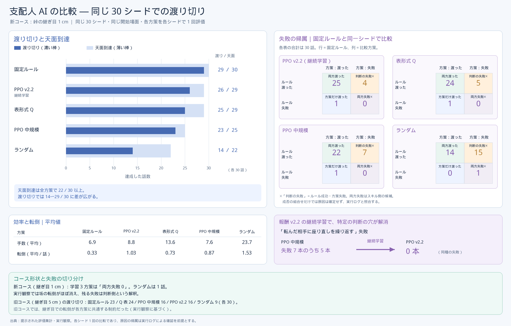

# 支配人 AI の設計書

本書は、提出動画の中で「パッカンが坂を登れずに座り込んだあと、次の一手を選ぶ」役を担う支配人 AI の設計を、採用した形だけまとめたものである。
経緯・試行錯誤・不採用案は [docs/devlog/MANAGER_DESIGN.md](devlog/MANAGER_DESIGN.md)（原文のまま保存）と [docs/insights.md](insights.md) に、評価の全表は [docs/results.md](results.md) にある。
数値には出所（ファイル、JSON のキー、コードの定数名）を併記する。文書にしか残っていない数値はその旨を断る。

登場する機体の呼び名は次のとおりで、以後は愛称に統一する（対応表は [docs/glossary.md](glossary.md)）。

- パッカン（Microduck, Pollen Robotics）：公式 ONNX ポリシー velstand／alpha_sitstand を推論のみで使う。取得先・版・ライセンスは `THIRD_PARTY.md`。コード識別子は `duck`／`MD`。
- 跳跳（Jumper, KingKong Robotics）：公式 ONNX ポリシー locomotion／jump／dance_crab を推論のみで使う（救助の場面で使うのは locomotion だけ）。取得先・版・ライセンスは `THIRD_PARTY.md`。
  コード識別子は `crab`／`JP`（定型文では愛称の「ちょーさん」と呼ばれる。以前の 2:47 版と比較用の動画の吹き出しでは「カニさん」）。
- ブルドーザー（BZ、自作 course-builder のルール制御）：救助の場面では東側に駐車して動かない（`manager2_env.py` `BZ_PARK`）。

## 1. 何をする AI か

支配人 AI は、座り込んだパッカンを跳跳の手助けで峠の向こうまで渡らせるために、6 つの手（スキル）から次の一手を選ぶ離散方策である。
入力はシミュレータの真値から組んだ 46 次元の観測（`crab_help.py` `OBS_DIM`）、出力は 6 手のうち 1 つ、吹き出しの文は手ごとの定型文で、文章生成モデルは使わない。
手の中身（歩く・座る・押す）は固定プログラムで、その内側ではパッカンと跳跳の公式ポリシーが推論している。支配人 AI が決めるのは「どの手を、いつ呼ぶか」だけである。

同じ観測・同じ手・同じスキル生成器を、学習環境（`manager2_env.py`）と本番の通し台本（`v7_full.py --manager rule|ppo|tabq`）が共有する（`crab_help.py`）。
学習環境でだけ、リセット時に機体の姿勢を書き込む配置を許す（`manager2_env.py` 冒頭の docstring）。動画では外力もテレポートも使わない。

支配人 AI は 3 方式を同じ環境で比べた。固定ルール（`crab_help.rule_action`、本プロジェクトで作成）、SB3 PPO の小型 MLP（`manager2_train.py`）、表形式 Q 学習（`manager2_tabq.py`）。
提出動画の本編は固定ルール版で、PPO 版・Q 表版も同じ台本で描画している（第 13 節）。

| 構成要素 | 既製／自作 | 推論／学習 | 出所 |
|---|---|---|---|
| 支配人 AI（固定ルール） | 自作 | 推論（学習なし） | `crab_help.py` `rule_action` |
| 支配人 AI（PPO、MLP 64×64） | 自作（Stable-Baselines3 2.9.2 で学習、`requirements.txt`） | 学習＋推論 | `manager2_train.py`、`out/manager_runs/ppo2_v22/` |
| 支配人 AI（表形式 Q、314 状態） | 自作 | 学習＋推論 | `manager2_tabq.py`、`out/manager_runs/tabq2_small/tabq.json` |
| スキルの中身（歩く・座る・押す） | 自作の固定プログラム | 推論なし | `crab_help.py` `SKILLS` |
| パッカンの velstand／alpha_sitstand | 既製（Pollen Robotics） | 推論のみ | `policies/microduck/`、`v7_policies.py` |
| 跳跳の locomotion（救助で使う。jump／dance_crab は救助の外） | 既製（KingKong Robotics） | 推論のみ | `../jumper/out/bundle_example/jumper/`、`v7_policies.py` |

## 2. 成功条件と場面ごとの担当

本作の成功条件は、ブルドーザーが組んだコースを 3 体すべてが渡ることである。ブルドーザーと跳跳は固定プログラムと公式ポリシーだけで渡れる。
パッカンは公式 velstand では 16.3° の坂（`manager2_env.py` `SLOPE` = atan2(0.44, 1.505)）を登れず、入口で足踏みして座り込む。ここから先が支配人 AI の担当である。

| 場面 | 進め方 | 動かしているもの | 支配人 AI の関与 |
|---|---|---|---|
| 施工（坂 2 枚を運んで組む） | 固定プログラム | course-builder `SlopeAssembly`（自作） | なし |
| ブルドーザーの走破 | 固定プログラム | course-builder の走行制御（自作） | なし |
| パッカンの坂挑戦と座り込み | 固定の台本 | velstand／alpha_sitstand（既製、推論） | 座り込みが確定するまで待つ |
| 跳跳の登坂・峠越え・下り | 固定の台本 | locomotion／jump（既製、推論） | なし |
| 跳跳が戻ってパッカンの後ろにつく | 固定の台本 | locomotion（既製、推論） | ここで引き渡し |
| 救助（パッカンを渡らせる） | 支配人 AI が 6 手から選ぶ | 各手の中で velstand／sitstand／locomotion が推論 | 判断の全部 |
| ゴールの万歳・ダンス | 固定の台本 | dance_crab ほか（既製、推論） | なし |

吹き出しは支配人 AI が手を選んだ瞬間だけ出す。固定プログラムの場面には出さない。これで「どこが AI の判断か」が画面上で区別できる。
提出動画の本編では、同じ瞬間に画面下の帯（支配人の帯）にも支配人の丸い顔とセリフが打ち込まれ、日本語が出そろうと英語の行（`crab_help.py` `LINES_EN`）が出る（描画のみ、`docs/video_guide.md` 第 1 節）。
救助の持ち時間は sim 240 s（`v7_full.py --rescue-max`、学習環境の `max_episode_s` と同じ）。

## 3. 6 つの手と定型文

1 手＝1 スキルで、スキルは生成器として書かれている。支配人 AI が手を選ぶとスキルが終わるまで走り（sim 4〜90 s）、終わると結果の文字列を返し、支配人 AI は次の観測を見て次の手を選ぶ。

| 手 | 中身（スキル） | 上限 | 吹き出し（`crab_help.py` `LINES`） |
|---|---|---|---|
| `WAIT` | 全員が止まる。転んだパッカンは velstand が自力で起こす | 4 s | ちょっと待とう |
| `SEAT` | 座っていれば立つ、座席（坂の入口 13 cm 手前）へ歩く、南（跳跳側）を向く、座る | 32 s | パッカン、ちょーさんの方を向いて座って |
| `PUSH` | 跳跳が線上の後ろに回り、整列し、0.12 m/s で触れ、0.3 m/s で天面まで押し、座り姿勢が落ち着くまで 0.12 m/s で添える | 90 s | ちょーさん、そっと押し上げてあげて |
| `BACK_OFF` | 跳跳が線に沿って真っ直ぐ下がり、0.6 m 離れる | 7 s | ちょーさん、少し離れて |
| `STANDUP` | 座っていれば sitstand の旗を下ろして velstand へ。転んでいれば velstand の自力復帰を待つ | 16 s | パッカン、立てる？ |
| `WALK_ON` | パッカンがコース中央線を北へ 0.3 m/s で歩く。天面、下り坂、床まで。跳跳は動かない | 30 s | パッカン、そのまま進んで |

定型文は `LINES` に 8 本ある。上の 6 本に加え、2 回目以降の `PUSH` は「もう一回いこう。ちょーさん、そっと押し上げてあげて」、転んだ相手に `PUSH` を選んだときは「ちょーさん、そっと押してずらしてあげて」になる（`bubble_line`）。
「ちょーさん」は跳跳（ちょうちょう）の愛称で、英語の行（`LINES_EN`、同じ 8 本）では Cho-san と書く（例：`SEAT` は “Pakkan, sit down facing Cho-san.”）。
後者は学習方策やランダム方策が選び得る手で、スキルは 1.5 s 待って `nothing` を返す（`skill_push` 冒頭）。固定ルールはこの手を選ばない。

スキル内の主な定数（`crab_help.py`）：押す線と歩く線はコース中央 `LANE_X` = 1.45 m、座席 `SEAT_Y` = −2.13 m（坂の入口 `TOE_Y` = −2.0 の 13 cm 手前）、座席判定 `SEAT_TOL` = 0.12 m。
押しは天面の縁 `PUSH_TO_Y` = −0.415 m（`CREST_Y` + 0.08）で終える。向きの許容 `FACING_TOL` = 15°。押す速度 `CRAB_PUSH_VX` = 0.3 m/s。
`PUSH` は 15 s 進まなければ `stalled`、`WALK_ON` は 10 s 進まなければ打ち切る。

## 4. 13 種の結果

スキルが返す結果は 13 種で、直前の結果として次の観測に one-hot で入る（`crab_help.py` `RESULT_SLOTS`）。

| 結果 | 意味 | 返すスキル |
|---|---|---|
| `none` | まだ手を打っていない（エピソード開始時） | — |
| `waited` | 4 s 待った | `WAIT` |
| `seated` | 南を向いて座った（向き 15° 以内、傾き 25° 未満）。座席に着いたかは判定しない（固定ルールが `near_lip` を足した理由、第 8 節） | `SEAT` |
| `pushed_up` | 天面に座った状態で落ち着いた | `PUSH` |
| `fell` | 手の途中でパッカンが転んだ | `SEAT`／`PUSH`／`STANDUP` |
| `stalled` | 進まなくなった（押しが 15 s 止まる、整列・接近の時間切れ、歩きが 10 s 止まる、下がれない） | `PUSH`／`BACK_OFF`／`WALK_ON` |
| `slipped` | パッカンが線から 0.45 m 以上外れた、または跳跳が線や坂から外れた | `PUSH` |
| `cleared` | 跳跳が 0.6 m 離れて接触が切れた | `BACK_OFF` |
| `standing` | パッカンが立って 2 s 安定した | `STANDUP` |
| `still_down` | 転んだまま起きられなかった | `SEAT`／`STANDUP` |
| `crossed` | 北側の床に立った | `WALK_ON` |
| `walked` | 0.2 m 以上進んだが渡れなかった | `WALK_ON` |
| `nothing` | 条件が合わず何も起きない（転んだ相手への `PUSH`、立っている相手への `STANDUP`、立っていない相手への `WALK_ON`、既に離れている `BACK_OFF`、座れなかった `SEAT`） | 5 手 |

## 5. 観測 46 次元の内訳

観測はシミュレータの真値から組む。実機なら俯瞰カメラで測れる量に限っている（`crab_help.py` `Helpers` の docstring）。
内訳は 3+2+4+2+6+7+13+6+3 = 46（`OBS_DIM`）。開発記録の一部にある「45 次元」は誤記で、コードの `OBS_DIM` と気分ネットの入力（46＋7 = 53）が 46 を裏づける。

| 区分 | 次元 | 内容 | 正規化（`observation`） |
|---|---|---|---|
| パッカンの位置 | 3 | 線からの横ずれ、入口からの進み、高さ | /0.5、/2.0、×2 |
| パッカンの向き | 2 | 南向きからのずれの sin、cos | — |
| パッカンの姿勢 | 4 | 座り／立ち（旋回を含む）／転倒／歩行の one-hot | — |
| パッカンの傾きと転倒時間 | 2 | 傾き（°）、転倒からの秒数 | /90、min(・,10)/10 |
| 進行段階 | 6 | `toe`／`ramp_up`／`deck`／`ramp_down`／`north`／`beside` の one-hot | — |
| 跳跳の相対状態 | 7 | 線からの横ずれ、パッカンとの前後差、距離、接触、高さ、北向きからのずれの sin・cos | /0.5、/1.5、/2.0、0/1、×2 |
| 直前の結果 | 13 | 第 4 節の 13 種の one-hot | — |
| 直前の手 | 6 | 6 手の one-hot（最初は全 0） | — |
| 帳簿 | 3 | 押し上げ回数、経過時間、コース部品の移動量 | min(・,3)/3、/240 s、/4 cm |

進行段階は `Helpers.stage()` が座標から決める。`toe`（入口手前）、`ramp_up`（入口から 3 cm 以上進み高さ 9 cm 超）、`deck`（天面）、`ramp_down`（下り坂）、`north`（北側の床）、`beside`（線から 0.5 m 以上外れた床の上）。

## 6. 開始場面と配置（学習環境）

1 エピソードは、パッカンが坂の入口で座り込んだ直後（または押し上げ直後の天面）から始まる。開始場面は 7 種を重みで引く（`manager2_env.py` `SCENARIOS`）。
配置のばらつきは位置 ±6 cm、向き ±10°、跳跳との間隔 0.55〜1.0 m、横ずれ ±0.15 m（`Scene.reset`）。配置後、パッカンは物理の中で立ち、座る場面では座る。

| 開始場面 | 既定の重み | 継続学習の重み | 意味 |
|---|---|---|---|
| `toe_seated_ok` | 0.30 | 0.20 | 入口の座席で跳跳の方を向いて座っている |
| `toe_seated_wrong` | 0.20 | 0.15 | 座っているが別の向き（40〜320°） |
| `toe_standing` | 0.20 | 0.15 | 立っている（向きは任意） |
| `toe_fallen` | 0.10 | 0.10 | 入口で倒れている |
| `deck_seated` | 0.15 | 0.15 | 押し上げ直後、天面に座っている |
| `deck_fallen` | 0.05 | 0.05 | 天面で倒れている |
| `ramp_fallen` | 0.0 | 0.20 | 坂の途中で倒れ、跳跳が下から密着している |

既定の重みは評価と最初の学習に使い、継続学習（PPO v2.2）だけ右の列に替えた（`out/manager_runs/ppo2_v22/train_summary.json` `draw_tables`）。
`ramp_fallen` は押しに失敗して転んだ直後の状態を再現する場面で、既定表では重み 0 のまま末尾に足し、乱数の呼び出し順も変えていない。これで同一シード評価の開始状態は以前と一致する。

跳跳の初期位置も重みで引く（`CRAB_SPOTS_*`）。入口では後ろ 0.65／横 0.25／密着 0.10、天面と坂では密着 0.70／後ろ 0.30。継続学習では入口を後ろ 0.5／横 0.2／密着 0.3 に変えた。

## 7. 報酬

1 ステップ＝1 スキルで、報酬はスキル終了時にまとめて与える（`manager2_env.py` `REWARD`、`ManagerEnv.step`）。

| 項目 | 値 | 条件 |
|---|---|---|
| 渡り切り | +10 | 北側の床で立ち、2 s 保つ（エピソード終了） |
| 天面到達 | +3 | エピソード中 1 回だけ |
| 経過時間 | −0.03/s | スキルの所要時間 |
| 転倒 | −1 ずつ | 1 手あたり最大 2 回まで数える |
| 無駄な手 | −1 | 座り直し済みなのに `SEAT`、`nothing` で終わった `PUSH`／`BACK_OFF`／`STANDUP`／`WALK_ON`、`stalled`／`slipped` で終わった手 |
| 無駄な待ち | −0.5 | 転倒中でも渡り切り後でもないときの `WAIT` |
| 時間切れ | −5 | 240 s |
| コース破損 | −10 | 坂 2 枚とブロック 2 個のどれかが 4 cm 動いた（エピソード終了）。許容値は course-builder と同じ |

報酬 v2.1 は上の表そのもので、評価はすべて v2.1 で行う。報酬 v2.2 は学習専用で、`still_down` で終わった `SEAT`／`STANDUP`（起きられない相手を立たせようとした手）にも無駄な手 −1 を加える。
設計判断：v2.1 では転んだ相手への `SEAT` は時間分（約 −0.4）しか引かれず、相手が近くにいないときの `BACK_OFF` は −1 だったため、PPO は「まず離れて場所を空ける」を学べなかった。v2.2 はこれをルールで押し付けずコストとして教える。

## 8. 固定ルールの条件

固定ルールは第 11 節の実験から書いた基準方策で、提出動画の本編でも使っている（`crab_help.py` `rule_action`）。「近い」は接触中または距離 0.5 m 未満。

| 状況 | 手 | 補足 |
|---|---|---|
| パッカンが転倒中、跳跳が近い | `BACK_OFF` | 直前の `BACK_OFF` が `stalled` なら `WAIT` |
| パッカンが転倒中、跳跳は離れている | `WAIT` | 手持ちに転んだ相手へ働きかける手がない |
| 北側の床にいる | `WAIT` | 渡り切り後 |
| 天面で座っていて、縁（`PUSH_TO_Y` − 5 cm）より手前、直前の押しが止まっていない | `PUSH` | 縁まで押し足す |
| 天面か下り坂で座っている（上以外） | 近ければ `BACK_OFF`、離れていれば `STANDUP` | 立たせる前に場所を空ける |
| 天面か下り坂で立っている | `WALK_ON` | 歩いて渡る |
| 入口・上り坂・脇で、直前の手が `stalled`／`slipped` で終わった（多くは押し）、跳跳が近い | `BACK_OFF` | 失敗した押しの後は必ず下がる。条件は直前の結果だけを見る |
| 座っていて南を向き、座席にいる／上り坂にいる／入口付近の線上にいる | `PUSH` | `at_seat` or `ramp_up` or `near_lip` |
| それ以外 | `SEAT` | 座り直し |

`near_lip`（線上で座席から入口 12 cm 先までの範囲）を `PUSH` の条件に加えたのは、座り直しが座席判定を 2 cm 外れると `SEAT` を繰り返して時間切れになる型を通し検証で見つけたためである（`Helpers.near_lip` の docstring）。
`RULE_NEAR_LIP = False` でこの条件を外した版に戻せる（評価 v2 の比較用）。

## 9. 学習方式：PPO と表形式 Q

### 9.1 設定

| 項目 | PPO（`manager2_train.py`） | 表形式 Q（`manager2_tabq.py`） |
|---|---|---|
| 入力 | 観測 46 次元をそのまま | 観測を 7 要素のキーに離散化：直前の結果｜姿勢｜進行段階｜南向き｜座席｜近接（接触中か 0.5 m 未満）｜押し回数（上限 2） |
| モデル | SB3 `MlpPolicy`、`net_arch=[64, 64]` | 辞書（状態キー → 6 手の Q 値）、学習後 314 状態 |
| 学習則 | lr 3e-4、γ 0.99、GAE λ 0.95、6 epoch、clip 0.2、エントロピー係数 0.02 | α 0.2、γ 0.95、ε-greedy 0.3→0.05（話数の 70% で線形に減衰）、同点はランダム |
| 並列・バッチ | `SubprocVecEnv` 12 並列、rollout 24 または 48 決定/環境、バッチ 64 | 単一プロセス、1 話ずつ更新 |
| 保存 | 2,000 決定ごとにチェックポイント（`--ckpt-every`） | 10 話ごとに `tabq.json` |
| 評価時の方策 | `deterministic=True`（argmax） | ε = 0 |

### 9.2 学習量

| 学習 run | 決定数／話数 | 実時間 | 学習中成功率 | 報酬 | 出所 |
|---|---|---|---|---|---|
| `ppo2_small` | 3,000／118 話 | 53.6 分（3,216 s） | 0.381 | v2.0 | `out/manager_runs/ppo2_small/train_summary.json` |
| `ppo2_medium2`（PPO 中規模） | 12,000／792 話 | 4 h 13 min（15,154 s） | 0.677 | v2.1 | `out/manager_runs/ppo2_medium2/train_summary.json` |
| `ppo2_v22`（PPO v2.2、medium2 から継続） | +12,000／766 話 | 4 h 28 min（16,105 s） | 0.658 | v2.2 | `out/manager_runs/ppo2_v22/train_summary.json` |
| `tabq2_small`（表形式 Q） | 120 話、314 状態 | 1 h 59 min（7,166 s） | 0.725 | v2.1 | `out/manager_runs/tabq2_small/train.log` 末尾 |

PPO 小規模は決定的方策の評価で 0/30 だった（`out/manager_runs/comparison_v2.md`）。この予算では手順を学べず、以後の比較からは外した。
更新は 11 回である。1 回は 12 並列×24 決定＝288 決定で、SB3 の `learn` は指定の 3,000 決定に届くまで集め続ける（`ppo2_small/train_summary.json` の `envs`・`rollout`・`steps`）。
`train_curve.json` の最後の話が 3,120 決定目に終わっていることが、10 回分の 2,880 決定を超えて 11 回目の収集が走ったことを示す。

PPO v2.2 は `ppo2_medium2` の重みと最適化器を引き継ぎ、報酬 v2.2 と第 6 節の継続学習の重みで学習した。学習中成功率が medium2 より低いのは、開始場面の分布を難しくしたためで、同じ 30 シードの評価では上がっている（第 10 節）。
学習はすべて CPU で行った。各 run の学習記録 `train_curve.json`（1 話 1 行）は `out/manager_runs/<run>/` にある。
1 決定 1 行の `train_env*.jsonl` は、本リポジトリには `out/manager_runs/ppo2_medium2/` の分だけを含める。

### 9.3 採用理由

- PPO を第一候補にしたのは、観測に連続量（向きのずれ、距離、傾き）が多く、離散化せずに境目を学ばせたかったからである。SB3 で学習・並列・記録がそろうことも理由とした。
- 表形式 Q を比較基準として残したのは、「次の一手を選ぶ」問題の状態が離散的に整理できる（直前の結果・姿勢・段階・座席・近接）ためで、学んだ表をそのまま読んで判断を説明できる。
- 固定ルールは基準方策であり、同時に提出動画の本編の支配人でもある。評価 v4 で最良だったため、本編にはこれを採用した。
- 設計判断：ブルドーザーのフォークでパッカンを扱う手（持ち上げ・押し倒し）は安全上の理由で行動集合から外した。手助けは跳跳が担う。旧行動集合の環境は `archive/manager_env.py` に履歴として残す。

## 10. 評価の設計：同一シード、独立性、スキルの信頼度、2×2

### 10.1 同一シード評価

評価は 30 シード（5000〜5029）を全方式で共有し、同じ開始場面・同じ配置から決定的方策で走らせる（`manager2_train.py eval --seed0 5000 --episodes 30`、`manager2_tabq.py eval`）。
比較表は `manager2_report.py` が `out/manager_runs/comparison_v4.md` に書く。最終結果は評価 v4（コース v2、エピソード独立）である。

| 方式（run） | 渡り切り | 天面到達 | 無駄な手／話 | 転倒／話 | 渡った回の中央時間 |
|---|---|---|---|---|---|
| 固定ルール（`baselines_v4`） | 29/30 | 100% | 0.07 | 0.33 | 90 s |
| PPO v2.2（`ppo2_v22_v4`） | 26/30 | 97% | 0.60 | 1.03 | 83 s |
| 表形式 Q（`tabq2_small_v4`） | 25/30 | 97% | 5.17 | 0.73 | 102 s |
| PPO 中規模（`ppo2_medium2_v4`） | 23/30 | 83% | 0.47 | 0.87 | 79 s |
| ランダム（`baselines_v4`） | 14/30 | 73% | 8.20 | 1.53 | 158 s |

コース破損は全方式 0（`out/manager_runs/comparison_v4.md`）。場面別・行動回数・失敗の型は `docs/results.md`。

図：評価 v4 の 5 方式の帯図。濃い帯が渡り切り、薄い帯が天面到達（いずれも 30 シード中の話数）。右側は固定ルールとの同一シード 2×2（第 10.4 節）。
数値の出所は `out/manager_runs/comparison_v4.md`。

### 10.2 評価の独立性の修正

評価 v2 までは `Scene.reset` が qpos／qvel／ctrl／act だけを初期値に戻していたため、MjData に残るソルバーのウォームスタートなどが前の話から持ち越され、同じシードでも前に走った話次第で物理がわずかに変わった。
`mujoco.mj_resetData` を先頭に入れて直した（`manager2_env.py` `Scene.reset`）。同コードのコメントにある実測：シード 5009 の 1 手目の押しが単独 66.0 s、別の話の後 63.8 s だったものが、修正後はどちらも 68.2 s で一致した。
修正前の表（評価 v2）は分布の比較としては成り立つが、シード単位の帰属には雑音が入るため、開発記録にだけ残す。

### 10.3 スキルの信頼度

スキルは正しい状態で呼んでも必ず成功するわけではない。この「状態 s で期待どおりの不成功」を支配人 AI の判断の失敗と分けるために、決定ログからスキルごとの結果の内訳を数える。
下表は評価 v4 の `eval_*.json`（`actions` と `results` の列）を `analysis/skill_stats.py` で集計した出力である（`python analysis/skill_stats.py out/manager_runs/baselines_v4/eval_rule.json`）。

| スキル | 固定ルール（正しい状態でだけ呼ぶ） | ランダム（状態を問わず呼ぶ） |
|---|---|---|
| `PUSH` | `pushed_up` 22/30（73%）、`fell` 5、`stalled` 3 | `pushed_up` 19/113（17%）、`nothing` 33、`stalled` 31、`fell` 30 |
| `SEAT` | `seated` 24/26、`nothing` 2 | `seated` 47/115、`still_down` 39、`nothing` 28 |
| `BACK_OFF` | `cleared` 35/36、`stalled` 1 | `cleared` 48/116、`nothing` 56、`stalled` 12 |
| `STANDUP` | `standing` 30/30 | `standing` 40/119、`still_down` 41、`nothing` 38 |
| `WALK_ON` | `crossed` 28/30、`walked` 2 | `crossed` 13/129、`nothing` 91、`stalled` 20 |

押し上げは正しい状態で呼んでも 73%（旧コースの評価 v2 では 22/35 = 63%、`docs/devlog/MANAGER_DESIGN.md` §7.6 の集計、再計算スクリプトなし）にとどまる。これはスキルの精度の限界である。
固定ルールはこれを「失敗した押しの直後は必ず `BACK_OFF`、座り直して再び `PUSH`」のやり直しで補い、天面到達 100% に持っていく。支配人 AI の学習が目指すのは、このやり直しの判断を状態から選ぶことである。

### 10.4 2×2 の帰属

各シードを、固定ルールとの同一シード比較で 4 つに分ける。両方渡った／ルールは渡ったが方策は失敗／方策だけ渡った／両方失敗。
「ルールは渡ったが方策は失敗」を判断の失敗の候補、「両方失敗」をスキルの失敗の候補として読む（`out/manager_runs/comparison_v4.md` 失敗の帰属）。

| 方式 | 両方渡った | ルールだけ渡った | 方策だけ渡った | 両方失敗 |
|---|---|---|---|---|
| PPO v2.2 | 25 | 4 | 1 | 0 |
| 表形式 Q | 24 | 5 | 1 | 0 |
| PPO 中規模 | 22 | 7 | 1 | 0 |
| ランダム | 14 | 15 | 0 | 1 |

読み方の注意：手順が違えば接触以降の物理の経路も変わるので、「ルールだけ渡った」の中には判断の良し悪しではなく経路の違いで結果が分かれた話も含まれる。

それでも PPO 中規模の失敗 7 本は、どれも転んで起きられない相手に `SEAT` か `STANDUP` を繰り返して `still_down` が続く型である。
うち 5 本（シード 5000・5002・5011・5018・5029）は押しで転んだ後の `SEAT` の連打で、固定ルールなら `BACK_OFF` で場所を空ける場面だから判断の失敗である。
残る 2 本（5003・5026）は `WALK_ON` の途中で転んだ後に `SEAT`／`STANDUP` と `WALK_ON` を交互に選んだ話で、第 14 節の「転んだ相手に打つ手がない」型に近い。
出所は `out/manager_runs/ppo2_medium2_v4/eval_ppo.json` の `actions`／`results`（型の分類は `docs/devlog/MANAGER_DESIGN.md` §7.15 にもある）。

評価 v4 の決定ログでは PPO 中規模の `SEAT` 114 回のうち 96 回が `still_down`、PPO v2.2 では `SEAT` 23 回で `still_down` は 0 回である。
出所は `out/manager_runs/ppo2_medium2_v4/eval_ppo.json` と `ppo2_v22_v4/eval_ppo.json` の `actions`／`results` の集計。報酬 v2.2 がこの穴を埋めた。

固定ルールの唯一の失敗（シード 5021）は、天面を歩いた後に下り坂の出口で転んで起きられず、`WAIT` を続けて sim 242 s で時間切れになった話である（`out/manager_runs/baselines_v4/eval_rule.json`、`falls` 1、`stage_end` `north`）。
転んだ相手に働きかける手が行動集合にないことが原因で、これは設計の不足として `docs/insights.md` に記す。

## 11. 鍵となる物理の発見

支配人 AI の手は、次の実験結果の上に組んである。いずれも物理のみ・外力なしで確認した。

### 11.1 座ったパッカンが跳跳の方を向くと縁で倒れない

立ったパッカンは跳跳が押すと最初の接触で倒れ、座ったパッカンは押せば登る。ただし坂の上を向いて座ると、押されている間に跳跳へ約 40° 寄りかかり、天面の縁で座面が水平に戻った瞬間に転ぶ。
向きを逆にして顔を跳跳へ、背中を坂へ向けると、傾きは坂の上側へ向き、縁で倒れ込む先がなくなる。実験 `v7_test_crab_push.py --seated --crest --face-crab --crab-vx 0.3` の記録（`out/v7_crab_push_cross.log`）：
押されている間の傾きは 6〜12°、62.1 s に天面へ、跳跳が 0.6 m 下がった後 69.2 s に自力で歩き出し、76.1 s に天面で一度転んで 1.8 s で復帰、86.6 s に北側の床へ渡った。
この実験は旧コース（継ぎ目の設計値 5 cm、第 12 節）で行った。76.1 s の転倒は継ぎ目（y +0.02〜+0.06 m、`docs/devlog/MANAGER_DESIGN.md` §7.3）を越えた y +0.13 m で起きており、第 12 節の継ぎ目のつまずきと考える。

坂の上を向いた版の 40° と縁での転倒は、`crab_help.py` 冒頭の docstring と `docs/devlog/MANAGER_DESIGN.md` §6.2b・§7.1 に記録がある（再計算スクリプトなし）。
この発見が `SEAT` の「南（跳跳側）を向いて座る」と `FACE_SOUTH` の定義になった。

### 11.2 押す速度は 0.3 m/s だけ

座ったパッカンを押す速度の掃引（`docs/devlog/MANAGER_DESIGN.md` §6.2b、`crab_help.py` `CRAB_PUSH_VX` のコメント）：0.2 m/s は 0.75 m 登ったところで 46° 後傾して転倒、0.3 m/s は 1.9 m を登り切って天面に到達、0.4 m/s は 16 s で転倒、0.5 m/s も転倒。
跳跳の胴体の高さは標準（`skill_push` の `posture[3] = 0.0`）が最良である。上げる（+4 cm）と転倒はしないが座ったパッカンを押し上げられずほぼ登れず、
下げる（−3／−5 cm）と転倒はしないが推力が出ず麓から動けない（`docs/devlog/MANAGER_DESIGN.md` §6.2b、再計算スクリプトなし）。したがって `PUSH` は接近 0.12 m/s、押し 0.3 m/s、天面での添え 0.12 m/s の 3 段で、途中の加速はしない。

### 11.3 座席は入口の 13 cm 手前

座席を入口の 35 cm 手前に置くと、平地を滑らされる間に座り姿勢が崩れ、入口で座面が斜面に乗る瞬間に転ぶ（`SEAT_Y` のコメントでは 20/20 で転倒）。
速度・向き・横ずれ・接触条件・入口手前の徐行や止まり直しを変えても同じだった（`docs/devlog/MANAGER_DESIGN.md` §7.3 の掃引、再計算スクリプトなし）。
座席を入口の 13 cm 手前（`SEAT_Y` = −2.13）にし、`SEAT` が座席へ 7 cm 以内に歩いて座るようにしてから、押し上げは安定した（`crab_help.py` `SEAT_Y` のコメント、`skill_seat` の到達許容）。
押す線はコース中央 `LANE_X` = 1.45 m とした。西端から 24 cm の線で押すと跳跳の左足が縁に乗って押しが止まり、天面でつまずいた後に西へ歩いて 0.44 m 落ちた（`LANE_X` のコメント）。

### 11.4 押しは天面の縁で終える

天面の 2 枚の継ぎ目を座ったまま押し越す案は、跳跳自身の体が峠をまたぐと locomotion が進めなくなるため採れなかった。縁を 0.8 m/s で押し切る案は下り側の坂を 7 cm 動かし（コース破損）、別の回では天面でパッカンが転んだ。
よって `PUSH` は天面の縁（`PUSH_TO_Y`）で終え、天面はパッカンが自分で歩く（`crab_help.py` `PUSH_TO_Y` と `skill_push` のコメント）。押し上げ後の跳跳は線に沿って真っ直ぐ下がる（`reverse_command`）。横に動かすと西の縁から落ちる。

## 12. コース v2（峠の継ぎ目 1 cm）

天面は 2 枚の部材の天板でできており、継ぎ目の幅は course-builder の設計値 `INSTALLATION_GAP` で決まる（`../physical-ai-course-builder/slope_assembly.py`、commit ea5b4e7）。
設計値 0.05 m のコース（旧コース）では歩くパッカンの足が継ぎ目に落ちてつまずき、6 シードの掃引で 0.3 m/s は 4/6、0.2 m/s は 3/6 しか渡れなかった（`crab_help.py` `WALK_DECK_VX` のコメント）。転倒後に velstand が起きられない回もあった。

設計判断：転んだ相手を助ける新しいスキルを足すより、施工側で継ぎ目を作らない方が確実と判断し、設計値を 0.01 m に変えた（コース v2）。
再施工後の継ぎ目の幅はレイキャストで 0.25〜1.25 cm（course-builder の commit ea5b4e7 のコミットメッセージと `docs/devlog/MANAGER_DESIGN.md` §7.14、再計算スクリプトなし）、天面開始の煙試験は 8/8 渡り切り・転倒 0（`out/manager2_smoke_gap1cm_deck.jsonl`）。

同じ 30 シード・同じ方策で、旧コース（評価 v3、`out/manager_runs/comparison_v3b.md`）とコース v2（評価 v4）を比べると、固定ルール 23→29、PPO v2.2 16→26、表形式 Q 24→25、PPO 中規模 16→23、ランダム 9→14 である。
環境の不備は学習方式に厳しく出る。旧コースの PPO v2.2 は `BACK_OFF` を 465 回使い（無駄な手 14.9／話）、押しが効かないと「下がる→押す」を繰り返していた。学習環境・評価・提出動画はすべてコース v2 で統一した。

## 13. 提出動画での支配人 AI

本編（固定ルール、`out/3body_arena_v7_take57.mp4`、2:37、提出動画では 0:18.1 から。動画の公開先は `README.md`）の支配人 AI は 5 手で、3 体とも渡り切り、コース部品は動かず、パッカンの転倒は 0 回だった。
出所は `out/v7_full_report_take57.json` の `manager.decisions`、`three_crossed`、`course_disturbed`（空）、`md_events`（`FALLEN` の記録なし）である。

時刻は提出動画 m:ss.s（本編 m:ss.s｜sim 秒）で書き、提出動画の時刻は本編の時刻＋18.14 s（講座の OP カードと自己紹介の長さ）である。
本編は 0:00〜0:44.1（sim 0〜176.4 s）が 4 倍速、0:44.1〜1:20.4（sim 176.4〜248.9 s）が 2 倍速、仲間を呼んで戻る 1:20.4〜1:24.3（sim 248.9〜264.6 s）が 4 倍速、
救助の 1:24.3〜2:16.7（sim 264.6〜369.4 s）が 2 倍速、輪へ集まる 2:16.7〜2:20.9（sim 369.4〜386.3 s）が 4 倍速、2:20.9 以降（輪の万歳）が等速である。
施工の完了は 2 倍速区間に入った後の本編 0:54.0（sim 196.1 s）である。区間と時刻は `events` の `t`／`video_t` から `python analysis/timeline_times.py out/v7_full_report_take57.json` が求める。

| 手 | 結果 | 開始（提出動画｜本編｜sim） | 所要（sim） |
|---|---|---|---|
| `SEAT` | `seated` | 1:42.4（1:24.3｜264.6 s） | 11.9 s |
| `PUSH` | `pushed_up` | 1:48.4（1:30.2｜276.5 s） | 71.3 s |
| `BACK_OFF` | `cleared` | 2:24.0（2:05.9｜347.9 s） | 1.7 s |
| `STANDUP` | `standing` | 2:24.9（2:06.8｜349.6 s） | 5.5 s |
| `WALK_ON` | `crossed` | 2:27.7（2:09.6｜355.2 s） | 14.2 s |

手・結果・sim 時刻・所要は、物理が同じ以前の 2:47 版（`out/v7_full_report_take51.json`、`state_digest` 一致）と同じである。

同じ台本で支配人 AI だけを替えた版も、以前の 2:47 版と同じ速度設定で描画した（いずれも 3 体渡り切り、コース部品の移動なし、各 JSON の `three_crossed`・`course_disturbed`）。
PPO v2.2 版は 4 手 `SEAT`→`PUSH`→`STANDUP`→`WALK_ON` で `BACK_OFF` を省く（`out/v7_full_report_take52.json`）。
Q 表版は 8 手 `STANDUP`→`WALK_ON`（`stalled`）→`SEAT`→`PUSH`→`BACK_OFF`→`STANDUP`→`STANDUP`（`nothing`）→`WALK_ON` で、歩かせて止まるのを見てから座り直す学習の癖が映る（`out/v7_full_report_take53.json`）。
追走版は固定ルール 5 手で、結末の演出だけが違う（`out/v7_full_report_take54.json`）。各版の動画時刻は `docs/video_guide.md`。

## 14. 分かったことと限界（要点）

- 行動 6・結果 13 の離散的な判断問題では、実験から書いた固定ルールが学習方式に勝った（29 vs 26 vs 25、`out/manager_runs/comparison_v4.md`）。設計者の知識「失敗した押しの直後は必ず下がる」をそのまま書けたためである。
  評価 v4 では、押しで転んだ直後に `BACK_OFF` を選んだのは PPO 中規模 2/7、PPO v2.2 8/8 で、固定ルールは失敗した押し（転倒 5・停止 3）の直後が 8/8 だった。
  出所は評価 v4 の `eval_*.json` の `actions`／`results` を数えた値（集計スクリプトなし）。
  旧コースの評価 v2 では PPO 中規模 3/10、固定ルール 13/13（`out/manager_runs/ppo2_medium2/eval_ppo.json`・`baselines_v2/eval_rule.json` の同じ集計、`docs/devlog/MANAGER_DESIGN.md` §7.7）。
- 学習方式の弱点は 2 つとも環境側の手当てで改善した。報酬 v2.2 は転んだ相手への `SEAT` 連打を無くし（第 10.4 節）、コース v2 は継ぎ目の転倒を無くした（第 12 節）。
- 残る共通の限界は「下り坂や入口で転んだ相手に打つ手がない」ことである。固定ルール唯一の失敗も、PPO v2.2 の失敗 4 本もすべてこの型（3 本は下り坂、1 本は入口）で、
  スキルの選択肢を増やさない限り越えられない（`out/manager_runs/ppo2_v22_v4/eval_ppo.json` の `stage_end` と `actions`／`results`）。
- 評価の独立性（第 10.2 節）と継続学習のチェックポイント保存（第 9.1 節）は、途中で見つけた不備を直したものである。前者が無いとシード単位の帰属に雑音が入り、後者が無いと中断した学習の重みが失われる。
- 観測は手設計で、シミュレータの真値に依存する。実機では俯瞰カメラ相当の計測が要る。コースは 1 種、スキルは 6 手で、他の失敗（たとえば跳跳が坂から落ちる）には対応していない。長版は `docs/insights.md`。

## 15. 出所のまとめ

| 内容 | ファイル |
|---|---|
| 手・結果・観測・固定ルール・座席と速度の定数 | `crab_help.py` |
| 学習環境（開始場面・配置・報酬・コース監視・独立化） | `manager2_env.py` |
| PPO の学習・評価・デモ | `manager2_train.py`、`out/manager_runs/ppo2_*/` |
| 表形式 Q の学習・評価 | `manager2_tabq.py`、`out/manager_runs/tabq2_small/` |
| 比較表と 2×2 | `manager2_report.py`、`out/manager_runs/comparison_v4.md`（旧コースは `comparison_v3b.md`） |
| 押し上げの鍵実験 | `v7_test_crab_push.py`、`out/v7_crab_push_cross.log` |
| 本番での支配人 AI の呼び出し | `v7_full.py --manager {rule,ppo,tabq} --run <run> --rescue-max 240` |
| 動画の判断ログ | 本編 `out/v7_full_report_take57.json`、比較用 `out/v7_full_report_take51.json`〜`out/v7_full_report_take54.json` の `manager.decisions` |
| 開発記録（経緯・不採用案・日付つき） | `docs/devlog/MANAGER_DESIGN.md`、`docs/devlog/HANDOVER.md` |
