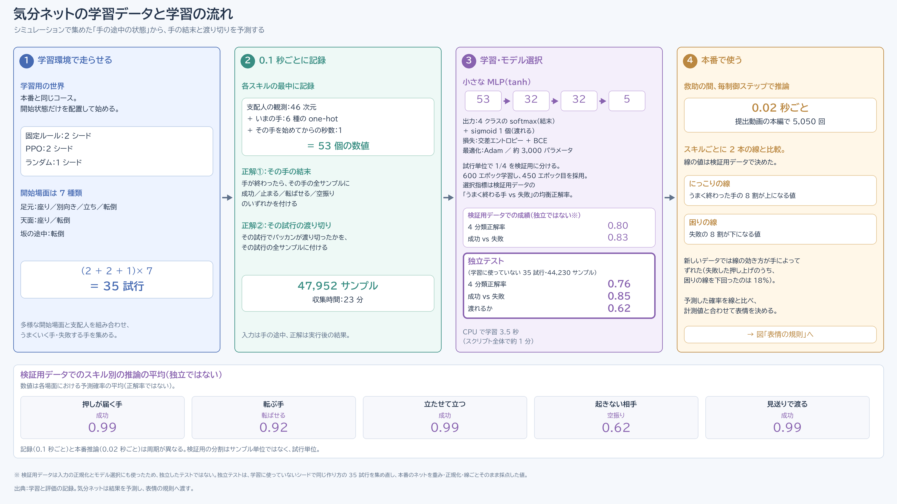
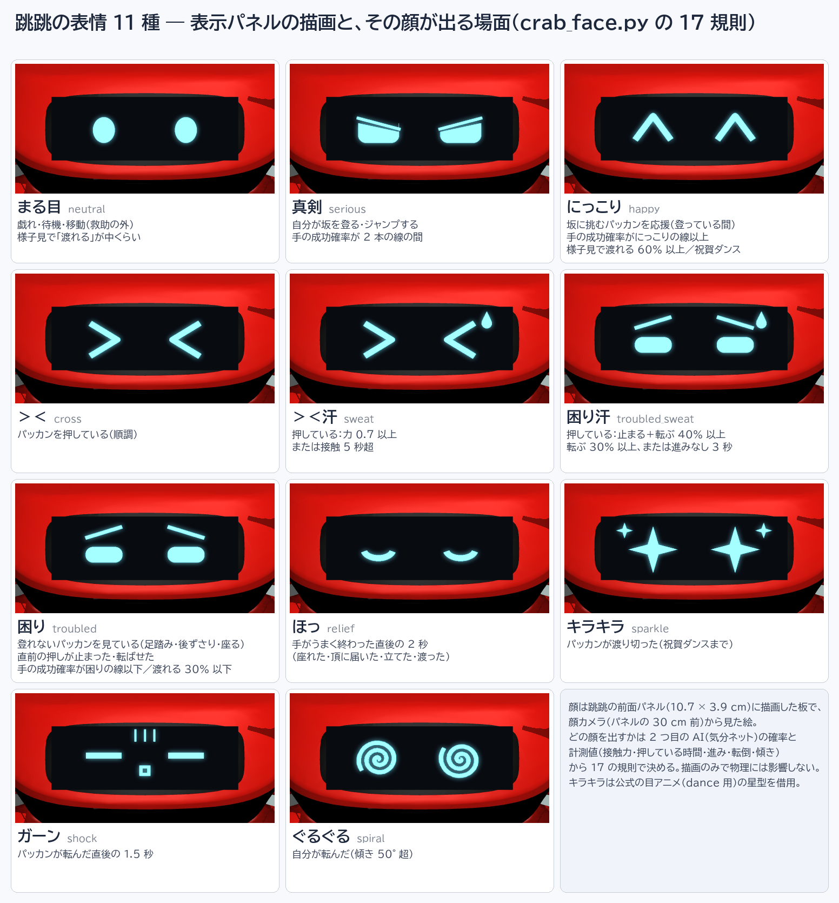
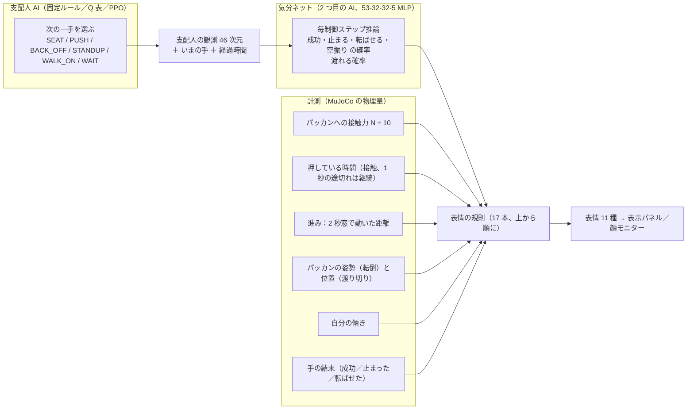
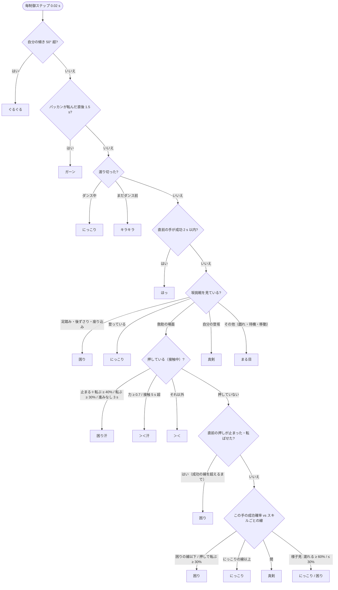

# 気分ネットと表情 — 跳跳の顔はどう決まるか

本書は、提出動画で跳跳（Jumper, KingKong Robotics）の顔を決めている 2 つ目の自作 AI「気分ネット」と、
その出力と計測値から表情を組み立てる規則の設計書である。データ収集、学習、しきい値、本番推論、
物理を変えないことの検証、採用しなかった案、実機の表情ディスプレイとの関係を順に述べる。
支配人 AI そのものは [manager_ai.md](manager_ai.md)、動画の時間軸は [video_guide.md](video_guide.md)、用語は [glossary.md](glossary.md) を参照。

## 要約

- 気分ネットは 53-32-32-5 の小さな MLP で、支配人 AI が今出している手が「成功／止まる／転ばせる／空振り」の
  どれで終わるかと、パッカン（Microduck, Pollen Robotics）が最終的に渡れるかを、救助の間 0.02 s ごとに推論する
  （`analysis/mood_train.py` MoodNet、`v7_full.py` CONTROL_DT）。
- 学習データは学習環境で 35 話・47,952 サンプル（`out/manager_runs/mood_net/meta.json` n_episodes, n_samples）。
  見送り分 10,772 サンプルで 4 分類の正解率 0.80、成功 vs 失敗の均衡正解率 0.83（同 metrics）。
- 表情は 11 種、優先順の 17 規則で決める（`crab_face.py` EXPRESSIONS、FaceDriver.choose）。入力は推論値と
  MuJoCo の計測値（接触力、押している時間、進み、転倒、傾き）の両方で、顔モニターに決め手の値を表示する。
- 顔と気分ネットは描画専用で物理を変えない。顔あり／なしのヘッドレス通しで最終状態の sha256 が一致した
  （`analysis/face_check.py`、`out/v7_full_report_facecheck_A.json`・`out/v7_full_report_facecheck_B.json`）。
- 提出版（固定ルール）での推論回数は 5,236 回（`out/v7_full_report_take51.json` `face.mood_ai.inferences`）。

## 位置づけ：2 つ目の AI は何を読み、何に触れないか

支配人 AI は失敗したときの次の一手を選ぶ（6 手）。気分ネットは同じ観測を読むが、手は選ばない。
読むのは「支配人の観測 46 次元（`crab_help.py` OBS_DIM）＋今の手の one-hot 6＋その手を始めてからの秒数」で、
出すのは確率 5 つだけである。この確率は表情の規則にしか使われず、どのロボットの関節目標にも戻らない。

| 項目 | 内容 | 既製／自作 | 推論／学習 |
|---|---|---|---|
| 気分ネット | 53-32-32-5 MLP、PyTorch、CPU 学習 | 本プロジェクトで作成 | 学習＋本番推論 |
| 表情の規則 | 17 本の優先規則＋計測しきい値 | 本プロジェクトで作成 | 固定（学習なし） |
| 顔の絵 11 種 | PIL で描画、発光材質 | 本プロジェクトで作成（キラキラの星型は公式アニメから借用） | — |
| 表示パネル | Jumper 前面板 `display_module_link`（公式 MJCF） | 既製（公式モデルの部位） | — |

気分ネットは固定ルール・表形式 Q・PPO のどの支配人とも別のネットワークである。支配人を入れ替えても
同じ重み（`out/manager_runs/mood_net/mood_net.pt`）を読む（`crab_face.py` MoodAI、`v7_full.py` `--mood-net`）。



図：データ収集→記録→学習→本番の 4 段と、見送り分のスキル別推論の平均。報告書の図（本プロジェクトで作成、
数値は `out/manager_runs/mood_net/meta.json`・`report.md` で照合）。図中の「CPU での学習時間 約 1 分」は
スクリプト全体の目安で、学習ループ自体は 3.5 s（meta.json train_s）。

## データ収集（analysis/mood_data.py）

学習環境（`manager2_env.py` Scene）で 3 種の支配人を走らせ、各手の最中を 0.1 s ごとに記録する。
記録するのは観測 46 次元、走っている手、その手の経過秒数、PPO の批評家の値 V（比較用）で、
手が終わった時点でその手の全サンプルに結末を、話が終わった時点で全サンプルに渡り切りの可否を付ける
（`analysis/mood_data.py` main、`--every 0.1`）。

| 条件 | 値 | 出所 |
|---|---|---|
| 支配人 | 固定ルール 2 シード、PPO v2.2 2 シード、ランダム 1 シード | `mood_data.py` `--policies rule ppo random`、`--seeds 2`、`--random-seeds 1` |
| 開始場面 | 7 種（足元で座り・別向き・立ち・転倒、天面で座り・転倒、坂の途中で転倒） | `manager2_env.py` SCENARIOS |
| 話数 | 35 話（固定ルール 14、PPO 14、ランダム 7） | `out/manager_runs/mood_data_episodes.json` |
| 打ち切り | 1 話 240 s または 40 手 | `mood_data.py` `--max-s 240`、`steps < 40` |
| サンプル | 47,952、638 手分（うまく終わる手のサンプル 69%、渡り切った話のサンプル 31%、話数では 20/35） | `mood_data.log` 末尾、`mood_data_episodes.json` steps・crossed |
| 収集時間 | 1,364 s（約 23 分、CPU） | 同上 |

ランダムな支配人を混ぜたのは、固定ルールと PPO だけでは失敗する手（転ばせる押し、起きない相手への
立たせ）が少なく、4 クラスの負例が集まらないためである。開始場面の配置は学習環境のリセット配置
（学習専用、提出動画には出ない）で、物理は学習時と同じ設定である（`mood_data.py` docstring）。

結末は 13 種の結果（`crab_help.py` RESULT_SLOTS）を 4 クラスにまとめる（`analysis/mood_train.py` CLASS_OF）。

| クラス | 含まれる結末 |
|---|---|
| 成功 success | seated, pushed_up, cleared, standing, crossed, walked, waited |
| 止まる stall | stalled, slipped |
| 転ばせる fall | fell |
| 空振り nothing | nothing, still_down |

## 学習（analysis/mood_train.py）

入力 53 は、観測 46 を収集した全サンプル（見送り分を含む）の平均と標準偏差で標準化したもの、手の one-hot 6、
経過秒数を 60 s で割って 1 で頭打ちにしたもの（`mood_train.py` features・main、T_SCALE）。ネットは 53→32→32→5、
活性化 tanh、パラメータ数は 2,949（層の形から計算）。出力の前 4 つは softmax で結末 4 クラス、5 つ目は sigmoid で
渡り切り。損失は交差エントロピー＋BCE、最適化は Adam（lr 1e-3、weight decay 1e-4）で、学習分 37,180 サンプルを
1 バッチにまとめて 600 エポック回す（`mood_train.py` MoodNet、loss_of、main）。

見送り分は話単位で切る（話 ID を 4 で割った余りが 3 の話、`mood_train.py` `test = (ep % 4) == 3`）。
サンプル単位で切ると同じ話の隣接サンプルが学習と検証の両方に入り、成績が実力より高く出るためである。
採用するエポックは 10 エポックごとに見送り分で測った「成功 vs 失敗」の均衡正解率（損失 ×0.01 を引く）が
最大のもので、600 中 450 エポック目になった（meta.json best_epoch）。学習ループは CPU で 3.5 s（meta.json train_s）。

成績（`out/manager_runs/mood_net/report.md` の転記）：

| 指標 | 分割 | n | 正解率 | 均衡正解率 |
|---|---|---|---|---|
| 4 分類 | 学習分 | 37,180 | 0.988 | — |
| 成功 vs 失敗 | 学習分 | 37,180 | 0.99 | 0.99 |
| 渡れる | 学習分 | 37,180 | 0.925 | 0.939 |
| 4 分類 | 見送り分 | 10,772 | 0.80 | — |
| 成功 vs 失敗 | 見送り分 | 10,772 | 0.80 | 0.83 |
| 渡れる | 見送り分 | 10,772 | 0.672 | 0.684 |

学習分と見送り分の差（0.99 対 0.83）の主因は、35 話という話数の少なさによる過学習と考える。「渡れる」の 0.67 は
話の結末を 35 本から学ぶには足りず、この出力は様子見（WAIT）のときだけ表情に使う（規則 15）。
本書の数値はすべて現行の 5 出力版のもので、初版（成功／失敗の 2 出力）は上書きされ、開発記録にだけ残る。

## スキル別の 2 本の線

気分ネットの p(成功) は手ごとに尺度が違う。天面に届く押し（PUSH→pushed_up）は 0.99 まで上がるのに、
座れた手（SEAT→seated）の平均は 0.35 で、座らせる手は転ばせる 0.34・止まる 0.24 と見分けがつかない
（`report.md` 見送り分の表）。そこで「にっこり」「困り」の線はスキルごとに引く（`mood_train.py` lines_for）。

| 線 | 決め方 | 出所 |
|---|---|---|
| にっこりの線 | 見送り分でうまく終わった手の p(成功) の 20 パーセンタイル（8 割がこの上） | `mood_train.py` lines_for、meta.json thr_smile_by_skill |
| 困りの線 | 見送り分で失敗した手の p(成功) の 80 パーセンタイル（8 割がこの下） | 同 thr_trouble_by_skill |
| 下限 | 困りの線がにっこりの線 −0.05 以上なら にっこり −0.10（最低 0.05）に下げる | `mood_train.py` lines_for |

| スキル | にっこり | 困り | 備考 |
|---|---|---|---|
| WAIT | 0.99 | 0.40 | 表情には渡れる確率を使う（規則 15） |
| SEAT | 0.04 | 0.05 | 困りの線は下限の 0.05。座らせる手はほぼ常ににっこり |
| PUSH | 0.99 | 0.06 | 転ばせる ≥ 0.30 を別に見る（規則 8・12） |
| BACK_OFF | 1.00 | 0.42 | |
| STANDUP | 0.98 | 0.75 | |
| WALK_ON | 0.99 | 0.29 | |

全体で引いた線は 0.34／0.29（meta.json thr_smile, thr_trouble）だが、本番では使われない。
見送り分のスキル×結末ごとの平均推論（`report.md` 転記、成功／止まる／転ばせる／空振り）：

| スキル→結末 | n | 成功 | 止まる | 転ばせる | 空振り |
|---|---|---|---|---|---|
| PUSH→pushed_up | 2,357 | 0.99 | 0.00 | 0.00 | 0.00 |
| PUSH→fell | 273 | 0.02 | 0.04 | 0.92 | 0.01 |
| PUSH→nothing | 135 | 0.15 | 0.22 | 0.03 | 0.59 |
| SEAT→seated | 2,573 | 0.35 | 0.24 | 0.34 | 0.08 |
| SEAT→still_down | 500 | 0.09 | 0.00 | 0.02 | 0.89 |
| BACK_OFF→stalled | 532 | 0.30 | 0.62 | 0.01 | 0.07 |
| STANDUP→standing | 295 | 0.99 | 0.00 | 0.00 | 0.01 |
| STANDUP→still_down | 640 | 0.35 | 0.01 | 0.02 | 0.62 |
| WALK_ON→crossed | 529 | 0.99 | 0.01 | 0.00 | 0.00 |
| WALK_ON→nothing | 50 | 0.21 | 0.00 | 0.02 | 0.77 |

転ばせる押しは 0.92 で見分けられ、起きない相手への立たせは空振り 0.62 で読める。
座らせる手だけは結末によらず似た値になる。座らせる手は相手の向きを変えるだけで、観測のうち
転倒や停滞に結びつく量がほとんど動かないためと考える。

## 本番推論（crab_face.MoodAI）

通し台本では、支配人が出番になる救助の段階（RESCUE）の間だけ、毎制御ステップ（0.02 s）に
支配人と同じ観測を気分ネットへ入れる（`v7_full.py` face_tick、CONTROL_DT）。
推論値は 0.5 s の時定数で平滑化し（`crab_face.py` MOOD_TAU）、規則が読むのは平滑化後の値である。
1 s ごとの標本が報告 JSON の `face.mood_ai.series` に残る（[t, p_success, p_stall, p_fall, p_nothing, p_cross]）。

提出版（固定ルール、`out/v7_full_report_take51.json`）での推論は 5,236 回。手ごとの p(成功) の中央値は、
SEAT 0.84（標本 11）、PUSH 0.99（72）、BACK_OFF 0.96（2）、STANDUP 0.99（5）、WALK_ON 0.98（14）で、
p(渡れる) は救助の開始時 0.08 から終了時 0.79 まで上がった（同 `face.mood_ai.series`）。
PUSH の標本の最小 0.57 は手が切り替わった直後の 1 標本で、平滑化が前の手の値を引きずったものである。

| 版 | 支配人 | 手数 | 推論回数 | 出所 |
|---|---|---|---|---|
| 提出版 | 固定ルール | 5 | 5,236 | `out/v7_full_report_take51.json` |
| PPO 版 | PPO v2.2 | 4 | 5,050 | `out/v7_full_report_take52.json` |
| Q 表版 | 表形式 Q | 8 | 5,239 | `out/v7_full_report_take53.json` |
| 追走版 | 固定ルール | 5 | 5,236 | `out/v7_full_report_take54.json` |

Q 表版では、足元で立たせる 1 手目に対して p(成功) 0.90 と STANDUP の線 0.98 の差で「真剣」が出る
（`out/v7_full_report_take53.json` `face.log` 264.6 s、規則 14）。支配人の手を 2 つ目の AI が割り引いて読む場面である。

## 表情 11 種



図：11 の顔を顔カメラから見た描画と、その顔が出る場面。`analysis/face_sheet.py` が生成
（`python analysis/face_sheet.py`、日本語フォントは OS 依存、`reproduce.md` の注記）。

| 顔 | 識別子 | 出る場面 | 規則 |
|---|---|---|---|
| まる目 | neutral | 戯れ・待機・移動、様子見で渡れるが中くらい | 17 |
| 真剣 | serious | 自分の登坂・ジャンプ、手の p(成功) が 2 本の線の間 | 16, 14 |
| にっこり | happy | 登っているパッカンを応援、p(成功) がにっこりの線以上、渡れる ≥ 0.60、祝賀ダンス | 7, 13, 15, 4 |
| ＞＜ | cross | 押している（順調） | 10 |
| ＞＜汗 | sweat | 押している：力 ≥ 0.7 または接触 5 s 超 | 9 |
| 困り汗 | troubled_sweat | 押している：止まる＋転ぶ ≥ 0.40、転ぶ ≥ 0.30、進みなし 3 s | 8 |
| 困り | troubled | 登れないパッカンを見ている、直前の押しが失敗、p(成功) が困りの線以下、渡れる ≤ 0.30 | 6, 11, 12, 15 |
| ほっ | relief | 手がうまく終わった直後 2 s | 5 |
| キラキラ | sparkle | パッカンが渡り切った（祝賀ダンスまで） | 3 |
| ガーン | shock | パッカンが転んだ直後 1.5 s | 2 |
| ぐるぐる | spiral | 自分が転んだ（傾き 50° 超） | 1 |

絵は 640×232 の画像として PIL で描き、発光する材質として表示パネルに貼る（`crab_face.py` _draw、TEX_W/TEX_H、
add_face）。パネルは公式モデルの前面板 `display_module_link`（10.7×3.9 cm）で、その 0.4 mm 手前に
描画専用の板（contype 0、conaffinity 0、density 0）を置き、表情は `model.geom_matid` の書き換えで切り替える。

通し台本の主カメラではパネルが小さく、押し上げ中は北を向いて見えないので、パネルの 0.30 m 前に
顔カメラを置き（CAM_DIST）、240×120 の顔モニターとして画面右上に合成する（PIP_W/PIP_H、`v7_full.py` の第 2 レンダラ、
`v6_common.py` Captioner.draw の inset）。

## 表情の規則（17 本、上から順）

毎制御ステップ、規則を 1 から順に調べ、最初に当てはまったものが顔になる（`crab_face.py` FaceDriver.choose）。
顔は最低 0.5 s 保つ（HOLD）。ぐるぐる・ガーン・接触の瞬間の ＞＜ は即時に切り替える。
確率の線には ±0.05 の余裕を持たせ、一度越えた線は 0.05 戻るまで越えたままにする（P_HYST）。





同じ判定を顔のアイコン付きで清書した図が `../report/face_rules_chart_ortiz.png`（報告書の図、本プロジェクトで作成、
条件と順番は `crab_face.py` の 17 規則と照合済み）である。

| 番号 | 条件 | 表情 |
|---|---|---|
| 1 | 自分の傾きが 50° 超（35° を切るまで、0.6 s 保持） | ぐるぐる |
| 2 | パッカンが転んだ直後、または押しが転倒で終わった直後 1.5 s | ガーン |
| 3 | パッカンが渡り切った、祝賀ダンスまで | キラキラ |
| 4 | 祝賀ダンス | にっこり |
| 5 | 直前の手がうまく終わった直後 2 s | ほっ |
| 6 | 坂挑戦を見ている：足踏み・後ずさり・座り込み | 困り |
| 7 | 坂挑戦を見ている：登っている（応援ダンス中も） | にっこり |
| 8 | 押していて接触中：p(止)+p(転) ≥ 0.40、p(転) ≥ 0.30、または進みなし 3 s | 困り汗 |
| 9 | 押していて接触中：力 ≥ 0.7 または接触 5 s 超 | ＞＜汗 |
| 10 | 押していて接触中 | ＞＜ |
| 11 | 直前の押しが止まった・転ばせた、p(成功) がにっこりの線を超えるまで | 困り |
| 12 | 押しに行く・座らせる・離れる・立たせる・見送る：p(転) ≥ 0.30（押しのみ）または p(成功) ≤ 困りの線 | 困り |
| 13 | 同じ手：p(成功) ≥ にっこりの線 | にっこり |
| 14 | 同じ手：線の間 | 真剣 |
| 15 | 様子見：p(渡れる) ≥ 0.60 ／ ≤ 0.30 | にっこり ／ 困り |
| 16 | 自分の登坂とジャンプ | 真剣 |
| 17 | それ以外（戯れ・待機・移動） | まる目 |

出所：`crab_face.py` docstring の規則一覧と FaceDriver.choose。規則 12 の「転ばせる」の判定を押しだけに限るのは、
座らせる手の転ばせる推定が結末によらず 0.34 前後で当てにならないためである（前節の表）。

## 計測しきい値の出どころ

| 値 | 線 | 決め方 | 出所（定数） |
|---|---|---|---|
| 成功確率 | にっこり／困り（スキルごと） | 見送り分の 20／80 パーセンタイル | meta.json thr_*_by_skill |
| 止まる＋転ばせる | 0.40 | 設計判断：成功 0.60 の裏返しとして置いた（データからの較正なし） | P_STALL_FALL、`devlog/face_rules_chart.md` |
| 転ばせる | 0.30 | 設計判断：転倒を最も避けたい結果として低めに置いた（押しのみ、較正なし） | P_FALL、`devlog/face_rules_chart.md` |
| 力 | 0.7（0.55 で解除） | 押している間の接触力 ÷ 10 N | EFFORT_HI/LO、PUSH_FORCE_REF |
| 接触時間 | 5 s | 設計要件：押し続けて 5 秒で汗 | PUSH_SWEAT_S |
| 進み | 2 s 窓で 2 cm 未満（押し中は 3 s） | 坂の入口で寄り直す 2 秒の停止を数えない | STALL_V×STALL_S、PUSH_STALL_S |
| 渡れる | 0.60／0.30 | 様子見のときだけ | P_CROSS_HI/LO |
| 傾き | 50°（35° で解除） | 転倒の判定 | TILT_ON/OFF |

力の目盛り 10 N は、ヘッドレス通しで測った押している間の接触力（法線成分の合計）の分布から決めた：
p10／p50／p90／最大 ＝ 0／6.4／10.2／13.5 N、パッカンの重さは約 15 N（開発記録の集計、再計算スクリプトなし；
`crab_face.py` PUSH_FORCE_REF の注記）。提出版の 1 s ごとの標本でも、力が掛かっている 49 標本の中央値 7.5 N、
最大 17.2 N で同じ桁である（`out/v7_full_report_take51.json` `face.effort_series`）。

力の計測には最初「脚のアクチュエータの力の合計」を試したが、歩行 4.9 と押し 5.4 N·m で差が出ず採用しなかった
（`crab_face.py` docstring）。接触は押している間 0.5 s ごとに途切れるので、1 s 途切れるまでは押し続きと扱う
（CONTACT_GAP_S）。停滞の計時は止まった時点から数え、段階（場面・挑戦の段階・押し）が変わるたびに仕切り直す
（FaceDriver.update）。

## 提出版の表情の時系列

提出版（`out/3body_arena_v7_take51.mp4`）の顔の変化 26 行を、動画時刻と sim 時刻で並べる。
出所は `out/v7_full_report_take51.json` の `face.log` で、`python analysis/timeline_times.py out/v7_full_report_take51.json`
が動画時刻（m:ss.s）に変換して出力する。動画は施工 ×4（0:00〜0:44.1）、以後 ×2、万歳 ×1（2:29.1〜2:47）。

| 動画 | sim | 表情 | 決め手 | 規則 |
|---|---|---|---|---|
| 0:00.0 | 0.0 s | まる目 | 戯れ・待機 | 17 |
| 0:54.1 | 196.5 s | にっこり | パッカンを応援 | 7 |
| 1:00.2 | 208.6 s | 困り | パッカンが登れない（坂に挑む） | 6 |
| 1:02.4 | 213.0 s | にっこり | パッカンを応援 | 7 |
| 1:05.4 | 219.0 s | 困り | パッカンが登れない（もう一回） | 6 |
| 1:10.3 | 228.9 s | 真剣 | 自分の登坂 | 16 |
| 1:18.9 | 245.9 s | まる目 | 待機 | 17 |
| 1:28.2 | 264.6 s | にっこり | 座らせる、p(成功) 0.80 | 13 |
| 1:34.2 | 276.5 s | ほっ | 座れた（2 s） | 5 |
| 1:35.2 | 278.5 s | 真剣 | 押しに行く、p(成功) 0.98 | 14 |
| 1:35.5 | 279.3 s | にっこり | 押しに行く、p(成功) 0.99 | 13 |
| 1:38.0 | 284.2 s | ＞＜ | 接触 | 10 |
| 1:38.3 | 284.7 s | ＞＜汗 | 力 0.7 | 9 |
| 1:39.4 | 287.1 s | ＞＜ | 力が 0.55 を切った | 10 |
| 1:40.5 | 289.2 s | ＞＜汗 | 接触 5 s 超 | 9 |
| 1:41.0 | 290.1 s | 困り汗 | 進みなし 3 s（接触 5.9 s 目） | 8 |
| 1:48.5 | 305.3 s | ＞＜汗 | 接触 5 s 超 | 9 |
| 1:49.9 | 308.0 s | 困り汗 | 進みなし 3 s（接触 23.8 s 目） | 8 |
| 1:51.8 | 311.8 s | ＞＜汗 | 力 0.8 | 9 |
| 2:09.8 | 347.9 s | ほっ | 天面に届いた | 5 |
| 2:11.7 | 351.6 s | にっこり | 立たせる、p(成功) 0.99 | 13 |
| 2:13.5 | 355.2 s | ほっ | 立てた | 5 |
| 2:14.5 | 357.2 s | 真剣 | 見送る、p(成功) 0.98 | 14 |
| 2:19.7 | 367.6 s | にっこり | 見送る、p(成功) 0.99 | 13 |
| 2:20.6 | 369.4 s | キラキラ | 計測：北の床で立位 | 3 |
| 2:29.1 | 386.3 s | にっこり | 祝賀ダンス | 4 |

この経路では 11 種のうち 9 種が出る。ガーンとぐるぐるは転倒がないので出ない（同 `face.log`）。
困り汗が 2 回出るのは、押し上げの最中に進みが 3 s 以上止まった区間が 2 つ（sim 290.1 s と 308.0 s）あるためで、
押し自体は 71.3 s で天面に届いている（`manager.decisions[1]` duration_s, result）。

表の決め手は `face.log` の理由の文と値（`stall_s`、`contact_s`、`effort`、`p_success`）から書いた。
止まった区間がコースのどこかは `face.log` に記録が無いので述べない。
PPO 版・Q 表版・追走版の時系列は、同じコマンドに `out/v7_full_report_take52.json`・`out/v7_full_report_take53.json`・
`out/v7_full_report_take54.json` を渡すと出る。

## 顔・気分ネットが物理を変えないことの検証（analysis/face_check.py）

描画専用の板は質量・接触・関節を持たず、顔カメラは力学に関わらない。気分ネットは観測を読むだけで、
出力はどの関節目標にも戻らない。これを通しで確かめるため、同じ台本をヘッドレスで顔なし（A）、
顔あり・固定の表（B）、顔あり・気分ネット（C）で走らせ、報告 JSON を比べる。`--face-ai` の既定は mood なので、
B では table を明示する（`v7_full.py` argparse）：

```
python v7_full.py --test --no-face --tag _facecheck_A
python v7_full.py --test --face-ai table --tag _facecheck_B
python v7_full.py --test --tag _moodcheck_C
python analysis/face_check.py out/v7_full_report_facecheck_A.json out/v7_full_report_facecheck_B.json
python analysis/face_check.py out/v7_full_report_facecheck_A.json out/v7_full_report_moodcheck_C.json
```

保存済みの `out/v7_full_report_facecheck_A.json` と `out/v7_full_report_moodcheck_C.json` を比べると、
出来事 1 件の文言の差（下の表）で終了コード 1 になる。ダイジェストと判断は一致する。

比較するのは sim 秒数、最終状態のダイジェスト（qpos＋qvel の sha256、`state_digest`）、出来事の時刻と文言、
支配人の判断、パッカンのモード変化、跳跳のモード変化、3 体渡り切り、コース破損の 8 項目で、
1 つでも違えば終了コード 1 になる（`analysis/face_check.py` main の checks）。

| 比較 | 条件 | 結果 | 出所 |
|---|---|---|---|
| A vs B | 顔なし／顔あり（表情は固定の表） | 8 項目すべて一致、ngeom 290→291（板 1 枚） | `out/v7_full_report_facecheck_A.json`・`out/v7_full_report_facecheck_B.json`、sim 385.6 s、出来事 64、判断 5 |
| A vs C | 顔なし／気分ネットあり（推論 4,518 回） | ダイジェスト・判断・モード変化・渡り切り一致、出来事は文言 1 件のみ差 | `out/v7_full_report_moodcheck_C.json` `face.mood_ai.inferences` |
| 提出版 | 省略あり ×2 版と省略なし ×4 版 | ダイジェスト 678fd3cae2caa4e7 が一致、判断 5 手が同じ sim 時刻 | `out/v7_full_report_take46.json`・`out/v7_full_report_take51.json` `state_digest` |

検証：本書の執筆時に A・B・C の報告 JSON を同じ 8 項目で比較し直し、上の表のとおりであることを確認した。
A vs C で違う出来事 1 件は文言だけで（「BZ faces south: the circle is complete」が C では
「BZ faces south, toward the goal: ...」）、C を記録したコード版で字幕の文言を変えたためである。時刻は 352.06 s で一致する。
描画版でも、顔付きの撮り直しが元の出来事の時刻と一致することで同じ結論を得た（`devlog/HANDOVER.md` §0b）。

教訓を 2 つ記す。描画版の物理は「フレームごとに呼ぶ `mj_forward`」込みで決定的なので、省略区間でフレームを
描かないようにしたとき `mj_forward` まで省いて経路が変わった。省略区間でも forward だけは毎フレーム呼ぶ
ことで直した（`devlog/HANDOVER.md` §0b、詳細は `insights.md`）。

施工を 4 倍速にした初版も、フレームの標本周期そのものを変えたため forward の回数が変わり、
ダイジェスト 768e78f7… の別経路になった（5 手・3 体渡り切りは同じ、`out/v7_full_report_take50.json`、`devlog/takes.md`）。
提出版は標本周期を ×2 のまま変えず、施工中は標本 2 枚に 1 枚だけを書き出す間引きにした
（`v7_full.py` `--build-speed 4`、build_write_every ＝ 4 ÷ SPEED["BUILD"] 2 ＝ 2）。
省略あり ×2 版とダイジェストが一致することで直ったことを確かめた。

## 採用しなかった案：支配人 PPO の批評家 V(s) を気分に使う

最初の案は、学習済みの PPO v2.2 の価値関数 V(s)（46-64-64-1）をそのまま「跳跳の気分」と読むものだった。
推論する AI が増えず、既に学習済みで、本物の推論でもある。学習環境で固定ルールと PPO を 7 場面 × 2 シード
走らせて 0.1 s ごとに V を記録し（28 話、25,214 サンプル、`analysis/face_value.py`）、
結果を `out/manager_runs/face_value.md` にまとめた。

| 区分 | V（中央値または単独の値） | 出所（face_value.md の表） |
|---|---|---|
| 開始時：足元で座り／足元で転倒／天面で座り／坂の途中で転倒 | −7.17／−17.22／+1.24／−27.95（単独の値） | 1 表目、seed 7000 の V 開始 |
| PUSH で接触中（PPO 走行／固定ルール走行） | −22.70／−22.86（中央値） | skill x contact の p50 |
| WAIT 中（PPO／固定ルール） | −34.59／−34.69（中央値） | skill x contact の p50 |
| STANDUP 中（PPO／固定ルール） | −0.75／+0.04（中央値） | skill x contact の p50 |
| 渡り切った話の終了時（PPO 12 話） | −8.09〜−27.63、すべて負（単独の値） | 1 表目、ppo・渡り切り ○ の V 終了 |
| 渡り切った話の終了時（固定ルール 11 話） | 正 4 話（+5.49〜+8.02）、負 7 話（−8.09〜−16.84） | 1 表目、rule・渡り切り ○ の V 終了 |

開始時の V は場面の難しさの順には並ぶ。しかし押し上げが順調に進んでいる最中も V は −22 のままで、
PPO の支配人で渡り切った話は終了時の V がすべて負になる（固定ルールの話は正と負が混ざる）。
批評家は決定点の状態しか学習しておらず、「坂の途中で密着」という状態は学習では転倒の開始場面としてしか
現れないので、成功している最中を絶望と読むと考える。表情の気分としては逆向きになるため採用しなかった。

V は報酬の尺度の見込みであって気分ではない、という設計上の結論が、手の途中を 0.1 s ごとに記録して結末で教える気分ネットにつながった。
この案は `v7_full.py --face-ai critic` で記録として残してある（`crab_face.py` MOOD_RUN）。

## 実機 Jumper の表情ディスプレイとの関係

実機の Jumper は 0.9 インチの丸い TFT ディスプレイを 2 つ、表情表示用に備える（`../jumper/docs/HARDWARE.md`
Interaction の行）。公式リポジトリに含まれる表情は dance タスク用の目のアニメ動画 1 本
（`tasks/jumper/dance/media/demo.mp4`：開く・まばたき・半目・キラキラ）で、本リポジトリの作者が調べた範囲では
ロボットの状態から表情を選ぶ API はない。公式の表情は「内容」であって「制御」ではない。

本作の顔はこの隙間を埋めるために本プロジェクトで作ったもので、公式に無い機能を公式のものとは呼ばない。
借りたのはキラキラの四芒星の形だけである（`crab_face.py` docstring）。実機と違う点も明記する：
本作は MJCF の前面板 1 枚（10.7×3.9 cm）に横長の絵を貼るが、実機は丸い画面 2 つなので、
実機に載せるには左右の目を 2 枚に分けて描く変換が要る。これは未実装である。

## 分かったこと・限界

- 事実：見送り分の正解率は学習分より低い（成功 vs 失敗 0.83 対 0.99、`report.md`）。原因：35 話という話数が少なく、
  話単位の見送りに対して過学習していると考える。対処：採用エポックを見送り分で選び、線も見送り分から引いた。
  話数を増やす（ランダム支配人のシードを増やす）のが次の手である。
- 事実：「渡れる」は 0.67 にとどまる。原因：話の結末は 35 本の標本しかなく、手の結末（638 手分、
  `mood_data_episodes.json` steps の合計）よりはるかに少ない。対処：この出力は様子見のときだけ表情に使う。
- 事実：座らせる手は結末によらず p(成功) 0.35 前後で、線は 0.04／0.05 になる（`report.md`）。原因：観測のうち
  座らせる手の成否に結びつく量が少ない設計の不足。対処：座らせる手は「押しに行く」としてにっこりで出し、
  判定は押しの最中に任せる。
- 事実：Q 表版の 7 手目（無駄な STANDUP、結果 nothing、1.0 s）で p(成功) は 0.24、p(止まる) は 0.73 まで動いたが、
  顔は直前の成功の「ほっ」（規則 5、2 s）のままだった（`out/v7_full_report_take53.json` `face.mood_ai.series` 355.6 s、
  `face.log` 354.96 s）。原因：出来事の規則が確率の規則より上にある優先順の設計で、1 s の手には追いつかない。未解決のまま記す。
- 事実：学習データは学習環境のリセット配置で集め、本番は通し台本で推論する。配置の分布は違うが、提出 4 本の押し上げ中の
  p(成功) の中央値は 0.99（0.988〜0.995）、p(転ばせる) の中央値は 0.006 以下（最大 0.04）で、見送り分の PUSH→pushed_up と
  同じ傾向だった（「本番推論」節の表の 4 ファイルの `face.mood_ai.series` のうち、`manager.decisions` の PUSH の区間）。
  転ばせる押しは提出 4 本の経路に含まれないので、その場面の推論は見送り分（PUSH→fell の p(転ばせる) 平均 0.92、
  `report.md`）でしか確かめていない。
- 事実：ガーンとぐるぐるは提出版の経路では出ない。原因ではなく仕様で、転倒が起きない経路だからである。
  出る顔は `analysis/face_sheet.py` の図で示した。

## 再現

いずれもリポジトリルートで実行する。所要時間は CPU の目安。

| コマンド | 所要 | 出力 | 照合先 |
|---|---|---|---|
| `python analysis/mood_data.py --seeds 2 --policies rule ppo random --name mood_data` | 約 23 分 | `out/manager_runs/mood_data.npz`、`out/manager_runs/mood_data_episodes.json` | 47,952 サンプル・35 話 |
| `python analysis/mood_train.py --data mood_data --out mood_net --epochs 600 --hidden 32 --seed 0` | 約 1 分（学習 3.5 s） | `out/manager_runs/mood_net/` | best_epoch 450、0.80／0.83 |
| `python analysis/face_value.py --seeds 2 --policies rule ppo --name face_value` | 未計測（28 話、上と同程度と考える） | `out/manager_runs/face_value.md` | PUSH 接触中 V −22 |
| `python analysis/face_sheet.py` | 未計測（描画 11 枚） | `report/faces_sheet_ja.png` | 11 種の顔 |
| `python v7_test_face.py` | 未計測（描画のみ） | `out/face_test/` | 各表情の PNG |
| A/B/C のコマンド（前節） | 描画なし | `out/v7_full_report_facecheck_A.json`・`out/v7_full_report_facecheck_B.json`・`out/v7_full_report_moodcheck_C.json` | ダイジェスト一致 |
| `python analysis/timeline_times.py out/v7_full_report_take51.json` | 数秒 | 標準出力 | 表情の時系列（動画時刻） |

データ収集は `--run ppo2_v22` の重み `out/manager_runs/ppo2_v22/ppo_manager.zip` を要する。
通し台本の顔は `--no-face` で外せ、`--face-ai {mood,critic,table}` で気分ネット／批評家／固定の表を選べる
（既定 mood、`v7_full.py` argparse）。乱数は台本内で固定で、同じコードなら物理は決定的である。

## 開発記録への案内

設計の経緯、版ごとの変更、作業時点の数値は `devlog/MANAGER_DESIGN.md` §7.16〜7.18 と `devlog/HANDOVER.md` §0b、
規則の図の原本は `devlog/face_rules_chart.md` にある。開発記録は原文のまま保存しており、本書と数値が異なる箇所は
`devlog/README.md` の訂正表に従う。
