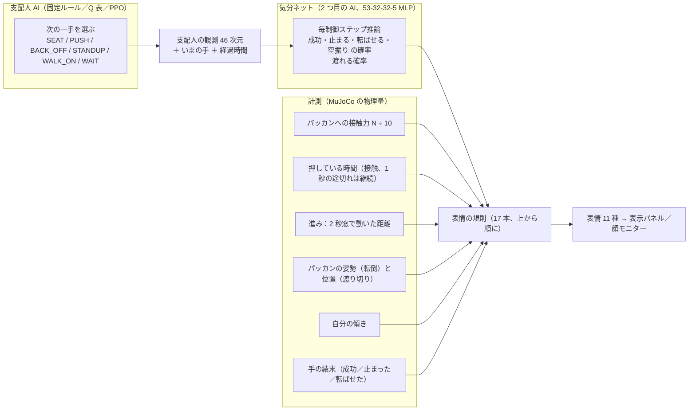
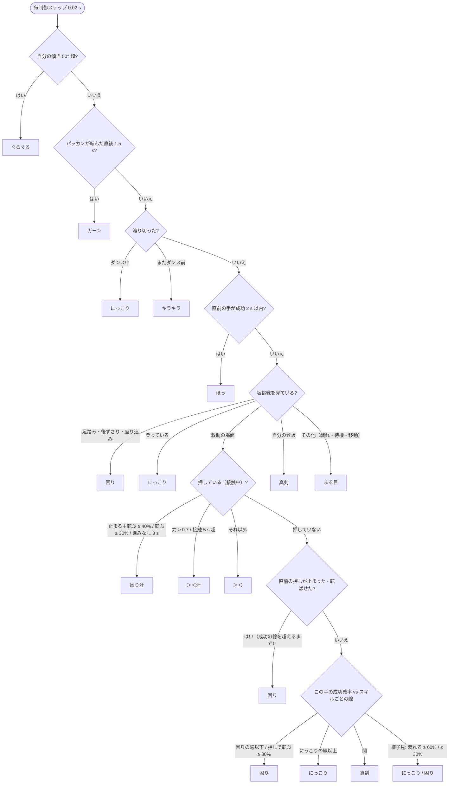
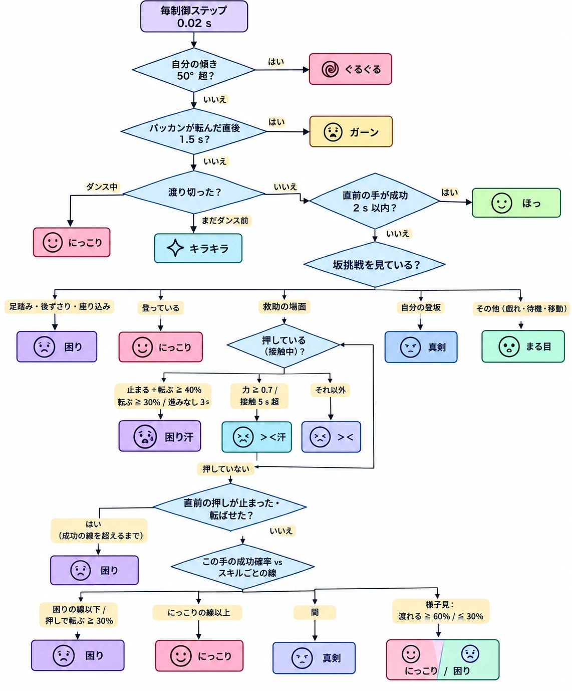

# 跳跳の表情の決め方（図）— レポート用

ゆうころ 10/28 夜「レポートを書くときはチャート図を作ったらいいかもね」。`crab_face.py` の 17 規則を、入力（推論・計測）→ 優先順位つきの判定 → 表情 の形で図にしたもの。Mermaid 記法（GitHub の README や Notion のコードブロック、VS Code のプレビューで図になる）。

## 入力

## 判定（上から順に、最初に当てはまった規則で決まる）

## しきい値の出どころ

| 値 | 線 | 決め方 |
|---|---|---|
| 成功確率 | にっこり／困り（スキルごと） | 見送り分で「うまく終わった手の 8 割が上」「失敗した手の 8 割が下」になる値（PUSH 0.99／0.06、STANDUP 0.98／0.75、WALK_ON 0.99／0.29、BACK_OFF 1.00／0.42、SEAT 0.04／0.05） |
| 止まる＋転ばせる | 40% | 成功 60% の裏返し |
| 転ばせる | 30% | 転倒は最悪の結果なので低い線（押しのみ） |
| 力 | 0.7（0.55 で解除） | 押している間の接触力 中央値 6.4 N、最大 13.5 N を 10 N で割った目盛り |
| 接触時間 | 5 秒 | ゆうころの指定 |
| 進み | 2 秒窓で 2 cm 未満（押し中は 3 秒） | 坂の入口で 2 秒止まって寄り直す動作を数えない |
| 渡れる | 60%／30% | 様子見のときだけ |

## 清書版（オルティス作、10/28 夜）

上の判定図をオルティス（ゆうころの AI 部門の先輩 AI）が顔のアイコン付きで清書したもの：`report/face_rules_chart_ortiz.png`（元は `.webp`）。島が規則 17 本と照合し、条件・順番とも `crab_face.py` と一致することを確認済み。レポートの図にはこちらを使う。

## 全体の仕組み図（オルティス作、10/28 夜）

`report/system_overview_ortiz.png`：島の依頼文（各 AI の方式と規模入り）からオルティスが描いた全体図（2 版のうち、流れが読みやすい整理版）。事実の照合済み：観測 46 次元、6 手、固定ルール／Q 表（状態キー 7 要素、120 話・2 時間）／PPO（46→64→64→6 と 46→64→64→1、12 並列 × 12,000 決定 × 2 回）、気分ネット（53→32→32→5、4 クラス softmax＋sigmoid、47,952 サンプル・35 話、450 エポック、正解率 0.80）、公式ポリシー（velstand 61 次元、locomotion 415 次元・200 Hz、jump 167 次元、dance_crab 209 次元、すべて ONNX・推論のみ）、表情の規則 17 本・11 の顔、描画は物理に戻らない。

## 支配人 AI の結果図（オルティス作、10/28 夜）

`report/results_managers_ortiz.png`：評価 v4（新コース、30 シード）の渡り切りと天面到達の棒グラフ、固定ルールとの同一シード 2×2、手数と転倒の平均、報酬 v2.2 で「転んだ相手に座り直し」の穴が 7 本中 5 本 → 0 本になった注記、旧コースとの比較。数値は `out/manager_runs/comparison_v4.md` と設計メモ §7.15 に一致することを確認済み。

## コースと 3 体の動線（オルティス作、10/28 夜）

`report/course_plan_ortiz.png`：上から見た全体図とコース拡大図。座標は `crab_help.py`（TOE_Y −2.0、CREST_Y −0.495、DECK_N_Y 0.548、DOWN_TOE_Y 2.05、LANE_X 1.45、SEAT_Y −2.13）と `v7_full.py`（MD_START、WAIT_SPOT、DUCK_LANE_X 1.2、CRAB_LANE_X 1.72、JP_PARK、CRAB_WATCH、CHEER_SPOT、CIRCLE_*）、`scene_fork_tracks.xml`（ブロック 4 個・ボール）に一致することを確認済み。

## 気分ネットの学習データと学習の流れ（オルティス作、10/28 夜）

`report/mood_net_pipeline_ortiz.png`：学習環境で走らせる（固定ルール 2・PPO 2・ランダム 1 シード × 7 場面＝35 話）→ 0.1 秒ごとに記録（46＋6＋1＝53 個、結末と渡り切りを正解に、47,952 サンプル・23 分）→ 学習・モデル選択（53-32-32-5、softmax 4＋sigmoid 1、CE＋BCE、Adam、450 エポック目、検証用 4 分類 0.80・成功 vs 失敗 0.83、CPU 1 分）→ 本番（0.02 秒ごと約 5,000 回、スキルごとの 2 本の線）。スキル別の推論の平均も `out/manager_runs/mood_net/report.md` と一致することを確認済み。

## 動画の構成タイムライン（オルティス作、10/28 夜）

`report/timeline_ortiz.png`（1600×800）：上の帯が 10 区間（主役ごとの色：BZ／パッカン／跳跳／支配人 AI／全員）、はさみ 2 つ（0:11 省略 32 秒、0:39 省略 62 秒）、星 3 つ（渡り切り：0:51 BZ、1:16 跳跳、2:18 パッカン）、支配人 AI の 5 手のピン（A 1:25 座らせる、B 1:31 押し上げ 36 秒、C 2:07 離れる、D 2:08 立たせる、E 2:11 見送る）、速度のかっこ（×2 0:00〜2:26、×1 2:26〜2:44）、下の帯が跳跳の顔のまとめ版 10 区間。時刻はすべて take 46 の出来事ログ（`out/v7_full_report_take46.json` の `video_t`）と表情ログに一致することを確認済み。顔の帯の区切りは表情ログの 23 区間をまとめたもの（1:02〜1:07 の困りは連続、星は 3 体とも「向こう側に降りた時刻」でそろえた）。

最初の版 `report/timeline_ortiz_v1_dense.png`（半分の大きさで保存）は、島の依頼が盛りすぎで同じ情報が帯・カード・表の 3 回出て読みにくかったため、載せるものを帯 2 本と印だけに絞って作り直した。経緯の記録として残す。

## レポート用の図の一覧（10/28 夜時点）

| 図 | ファイル | 作者 |
|---|---|---|
| 全体の仕組み（2 つの AI と 3 体） | `system_overview_ortiz.png` | オルティス（島の依頼文から） |
| 表情の決め方（17 規則のチャート） | `face_rules_chart_ortiz.png`（元 `face_rules_chart.md` の Mermaid） | オルティス |
| 支配人 AI の比較（30 シード、2×2） | `results_managers_ortiz.png` | オルティス |
| コースと 3 体の動線（平面図） | `course_plan_ortiz.png` | オルティス |
| 気分ネットの学習データと学習の流れ | `mood_net_pipeline_ortiz.png` | オルティス |
| 表情 11 種の一覧（描画そのもの） | `faces_sheet_ja.png`（`analysis/face_sheet.py`） | 島 |
| 動画の構成タイムライン（帯 2 本と印） | `timeline_ortiz.png`（初版 `timeline_ortiz_v1_dense.png` は記録用） | オルティス |
